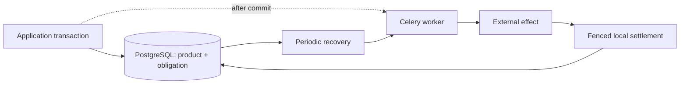

# Due
[](https://github.com/gigaverse-app/due/actions/workflows/ci.yml)
[](pyproject.toml)
[](package/docs/integration.md)
[](package/src/due/py.typed)
[](package/LICENSE)
[](https://due.readthedocs.io/en/latest/)

**An attempt can end. The obligation remains.**

[Start the tutorial](package/docs/quickstart.md) · [All eight chapters](package/docs/tutorial.md) · [Choose an API](package/docs/api-guide.md) · [Documentation](https://due.readthedocs.io/en/latest/)

The PyPI distribution name is **`django-due`** (`pip install django-due`).
Python imports remain **`due`**. See [releasing](RELEASING.md) for the manual release process.

## The database committed. The worker never heard.

You save a document and queue its publication. The broker is unavailable. Or the
worker writes the file and dies before recording success. Or a slow worker
returns after a newer revision has already finished.

**Due keeps track of what your Django application still owes.** It records the
obligation in PostgreSQL alongside the product change, uses Celery to attempt it,
and recovers work after lost messages and dead workers. Captured ownership tokens
and revisions prevent an old worker from settling a newer obligation.



The message gets work started sooner. The database remembers what remains owed.

[When Due is the right tool: strengths, tradeoffs, and alternatives →](docs/why-due.md)

## Start here: run and recover a background task

The [first tutorial](package/docs/quickstart.md) uses one deliberately trivial
function: sleep, print a greeting, return it. A prepared project supplies setup.

Define the task in `examples/hello_due/tasks.py`:

```python
import os
from time import sleep

from django.conf import settings
from django.tasks import task


@task(queue_name=settings.CELERY_TASK_DEFAULT_QUEUE)
def greet(name: str, seconds: int = 1) -> str:
    print(f"Starting greeting for {name} in process {os.getpid()}", flush=True)
    sleep(seconds)
    message = f"Hello, {name}!"
    print(message, flush=True)
    return message
```

Then submit it from application code or a Django shell:

```python
from examples.hello_due.tasks import greet

result = greet.enqueue("Ada")  # Returns immediately; a worker runs the function.

# After the worker finishes:
result.refresh()
print(result.return_value)  # Hello, Ada!
```

Submit a job before starting its worker. Read the saved result. Then kill a
worker during a slow task, restart it, and let Due recover that same job. Each
step shows the code, expected output and the behavior it demonstrates. The
[runnable example](examples/hello_due/README.md) has a test that performs the real
worker kill and waits for recurring recovery.

Import production types and startup helpers from `due.django.public`; common contract and fault
helpers live in `due.django.conformance`. [API choices, imports and file map →](package/docs/api-guide.md)

The [setup guide](package/docs/django-tasks-quickstart.md) explains how to add Due
to your Django project. The [eight-chapter tutorial](package/docs/tutorial.md)
then introduces each capability with small operations and observable results:

1. Run a task and recover it after worker death.
2. Capture input and guard completion with `ReplaySafeEffect`.
3. Keep a mutable external view current with `Projection`.
4. Move or cancel a deadline with `ScheduledAction`.
5. Preserve an uncertain outcome with `DurableExternalOperation`.
6. Resolve it by reading a receipt with `ObservedExternalOperation`.
7. Recover cleanup with `IndependentCompensation` and coordinate calls with `OwnedDurableWorkCapability`.
8. Compose stages, try completion inline and bind application contract tests.

Then follow [Acme Printworks](docs/acme-printworks-tutorial.md) from a Django task
to proof publication, portal repair, print ordering and cleanup. Its
[runnable app](examples/acme_printworks/README.md) includes application contracts.
Build those contracts alongside your first native capability: the real commands,
provider faults and customer-visible observations make recovery promises testable.

## What happens when things go wrong?

| Failure | Due's response |
| --- | --- |
| Commit succeeds; queue publication is lost | Recovery finds the work and reserves another delivery. |
| The broker delivers the same message twice | Only the captured owner can execute and settle it. |
| A worker dies or returns after its lease expires | Recovery handles the expiry; stale settlement is rejected. |
| Desired inputs change during execution | Revisions fence old settlement; the current target stays owed. |
| A non-repeatable request times out | Its outcome stays **UNKNOWN** until correlated evidence resolves it. |
| One recovery row always raises | Other identities progress; the failure is reported and held with backoff. |
| Retries are exhausted | Work remains visibly stopped for an explicit application decision. |

A local lease cannot cancel an external request. **Due does not promise
exactly-once external execution.** Your application defines replay safety,
provider idempotency, evidence, and success. [Guarantees and limits →](package/docs/architecture.md)

```text
commit product + obligation --> notify worker --> execute --> fenced settlement
             |                       X lost
             +------ recurring recovery --------> execute --> fenced settlement
```

[Follow a real obligation through message loss and process death →](docs/recovery-walkthrough.md)

## More than a task queue

Use Due when a business obligation must survive the attempt that tried to
fulfill it. Celery remains the transport; your application retains its own
models, transactions and product logic.

| What your application owes | Start with |
| --- | --- |
| A safely repeatable effect | `ReplaySafeEffect` |
| An external view of changing desired state | `Projection` |
| An action at a movable or cancellable deadline | `ScheduledAction` |
| A non-repeatable operation, such as a provider request with an uncertain outcome | `DurableExternalOperation` |
| Periodic observation of an uncertain operation | `ObservedExternalOperation` |
| Cleanup owed even if the original worker dies | `IndependentCompensation` |
| Fenced completion on a row with an existing lifecycle | [Completion leases](package/docs/completion-leases.md) |

The same work-table runtime also supports dependent wakes, discovery from
persisted facts, execution gates, continuations, status mirrors and captured
inputs. [Capability guide and executable examples →](package/docs/capabilities.md)

**Alpha, Django-backed.** Extracted from Gigaverse's work-table primitive; the API
may change before 1.0. Only work-table composition is public. Native-table
composition is excluded. [Verification scope and limits →](package/docs/verification.md)

## Coming from another library?

**Using Django Tasks?** Due includes an optional backend for `django.tasks`.
Keep `@task`, `.enqueue()` and `TaskResult` while adding transactional admission,
crash recovery, delayed tasks and named queues. [Setup and guarantees →](package/docs/django-tasks.md)

Start with [your library's migration guide](package/docs/migrations.md). Each guide
covers the benefits of adopting Due, a concrete migration, behavior to preserve,
cutover and rollback, and whether a compatibility layer would help. Guides cover
Procrastinate, DBOS, RQ, Django Tasks, Celery and the other Python libraries in
[the background-work ecosystem overview](docs/alternatives.md).

## Install

Requires Python 3.14, PostgreSQL and a Django 6 application. Celery needs a broker
and a running worker plus a recurring recovery scheduler (normally Celery Beat).
The integration suite uses PostgreSQL 17 and Redis 7.

Install the published package and commit the resolved version in your lockfile:

```bash
uv add 'django-due[redis]'
```

The documentation under `latest` follows main. Check your installed version
against the release notes before using an API added after that release.

Use the [task tutorial](package/docs/quickstart.md) and its prepared example.
They use source to include the consolidated imports added after
0.10.0. For an existing application, follow the [Django Tasks reference](package/docs/django-tasks.md)
or [native integration reference](package/docs/integration.md). Both need registration
in every process, workers and recurring recovery.

## Run the example

This quickstart runs the minimal [document-publication application](examples/documents/README.md).
The separate [Books application](examples/books/README.md) adapts Procrastinate’s
Django books demo into a Due workflow and documents its upstream provenance.

```bash
git clone https://github.com/gigaverse-app/due.git
cd due
uv sync --all-packages --locked
docker compose up -d
export DJANGO_SETTINGS_MODULE=examples.settings
uv run python -m django migrate
# Separate terminals, with the same settings:
uv run celery -A examples.celery_app:app worker --loglevel=INFO -Q due
uv run celery -A examples.celery_app:app beat --loglevel=INFO
```

Create a document from another terminal:

```bash
DJANGO_SETTINGS_MODULE=examples.settings uv run python -m django shell -c \
  'from examples.documents.models import Document; from examples.documents.effects import request_publication; document = Document.objects.create(); print(request_publication(document.pk, "Hello from Due").pk)'
```

The worker writes an immutable revision object under `/tmp/due-documents` and
publishes its key on the document row. Configure `DUE_DATABASE_URL`,
`DUE_BROKER_URL`, `DUE_OUTPUT_DIR` and `DUE_QUEUE` as needed. Compose credentials
are for local development only; both service ports bind to localhost.

## See recovery survive a lost message

For a browser application with two independently recoverable stages, run the
[books indexing demo](examples/books/README.md). See the
[example catalog](examples/README.md) for setup and contribution conventions.

With the local services running:

```bash
uv run pytest integration_tests/integration/test_celery_worker.py -v
```

This test commits a document and its publication obligation while withholding the
initial notification. It then starts a **separate Celery prefork worker**, sends
the recovery task through **Redis**, and checks the file and product state in
**PostgreSQL**. [Read the complete failure history](integration_tests/integration/test_celery_worker.py).

For application-bound recovery, replay, revision, admission and real process-death checks:

```bash
uv run pytest integration_tests/conformance -p due.django.conformance.reporting \
  --due-work-summary --due-work-profile-report=profiles.json --durable-work-report=effects.json
```

[pytest-obligation](https://github.com/gigaverse-app/pytest-obligation) generates
the applicable tests from a contract bound to Due's actual coordinator. CI
requires executed passing evidence for the claimed profiles; an empty or filtered
report fails. These proofs cover the bound example, not arbitrary application
callbacks. Enroll your own capability with `effect_contract_suite` and
`EffectExamples`: [authoring guide](package/docs/conformance.md),
[API and module map](package/docs/conformance-api.md),
[executable example](integration_tests/conformance/document_examples.py),
[verification scope](package/docs/verification.md).

## Inspect stopped work

```bash
uv run python -m django due_status
uv run python -m django due_status publish_document --limit 10
```

The read-only command reports exhausted, terminal-failed and unknown work,
unresolved attempts, and deferred recovery identities. It never authorizes a
replay. [Operations and monitoring →](package/docs/operations.md)

## Documentation

| You want to… | Read |
| --- | --- |
| Run a task and recover it after worker failure | [First task tutorial](package/docs/quickstart.md) |
| Learn each capability step by step | [All eight tutorial chapters](package/docs/tutorial.md) |
| Configure Due in a Django project | [Setup guide](package/docs/django-tasks-quickstart.md) |
| Learn native admission and completion hooks | [Native work lesson](package/docs/native-work-tutorial.md) |
| Find the high-level API and imports | [API guide and file map](package/docs/api-guide.md) |
| Add richer product guarantees | [Printworks tutorial](docs/acme-printworks-tutorial.md) |
| Decide whether Due fits your application | [Strengths and tradeoffs](docs/why-due.md), [alternatives](docs/alternatives.md) |
| Integrate the runtime | [Django and Celery wiring](package/docs/integration.md), [capabilities](package/docs/capabilities.md) |
| Move an existing application onto Due | [Migration settings and stable wire names](package/docs/integration.md#migrating-an-existing-application), [library migration guides](package/docs/migrations.md) |
| Prove your application's obligations | [Conformance walkthrough](package/docs/conformance.md), [checked immutable inputs](package/docs/conformance.md#prove-an-immutable-input-declaration), [executable document adopter](integration_tests/conformance/document_examples.py) |
| Find an interface or understand scope | [Conformance API, field reference and module boundaries](package/docs/conformance-api.md), [provider-seam factories](package/docs/conformance-api.md#derive-routine-bindings-from-one-provider-seam) |
| Understand a passing result | [Verification scope](package/docs/verification.md), [architecture and limits](package/docs/architecture.md) |
| Operate and recover work | [Operations](package/docs/operations.md), [failed-tick evidence](package/docs/operations.md#failed-infrequent-recovery) |
| Edit the library inside an adopter checkout | [Package ownership and subtree development](package/docs/development.md) |
| Migrate the backend harness | [Backend adoption and ownership](package/docs/backend-adoption.md) |

## Contribute

```bash
uv sync --all-packages --locked
uv run pre-commit install
uv run pre-commit run --all-files
docker compose up -d --wait
(cd package && ../.venv/bin/python -m pytest --due-work-check-fixtures)
uv run --no-sync pytest --due-work-require-assessed --due-work-profile-report=profiles.json
uv build --project package --out-dir dist
```

Pre-commit uses the Ruff and Pyrefly versions in `uv.lock`. CI also tests the
minimum Django version, checks migrations, and installs the wheel without test
dependencies. See [CONTRIBUTING.md](CONTRIBUTING.md) for the complete workflow.

[Integration](package/docs/integration.md) · [Architecture](package/docs/architecture.md) ·
[Conformance](package/docs/conformance.md) · [Recovery walkthrough](docs/recovery-walkthrough.md) ·
[Verification](package/docs/verification.md) · [Apache-2.0](package/LICENSE)

---

[](https://github.com/gigaverse-app/ci-esta)
[](https://github.com/gigaverse-app/pytest-selective)
[](https://github.com/gigaverse-app/pytest-obligation)

<sub>Pull requests run only the [test lanes](.github/test-lanes.json) a change can
affect, behind CI-esta's required-check gates; every run gets a CI-esta
[timing report](.github/workflows/observe-ci.yml). Due's conformance lane runs the
pytest-obligation tests generated from its contracts.</sub>

### How this project keeps CI fast

See the [CI toolkit integration](docs/ci-toolkit.md) for lane selection, validated
environment caches, required gates and real dependency critical-path reports.
