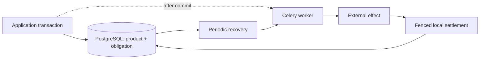

# Due

**An attempt can end. The obligation remains.**

[](https://github.com/gigaverse-app/due/actions/workflows/ci.yml)
[](pyproject.toml)
[](package/docs/integration.md)
[](package/src/due/py.typed)
[](package/LICENSE)

The PyPI distribution name is **`django-due`** (`pip install django-due`).
Python imports remain **`due`**. See [releasing](RELEASING.md) for the manual release process.

## The database committed. The worker never heard.

You save a document and queue its publication. The broker is unavailable. Or the
worker writes the file and dies before recording success. Or a slow worker
returns after a newer revision has already finished.

**Due keeps track of what your Django application still owes.** It records the
obligation in PostgreSQL alongside the product change, uses Celery to attempt it,
and recovers work after lost messages and dead workers. Captured ownership tokens
and revisions prevent an old worker from settling a newer obligation.



The message gets work started sooner. The database remembers what remains owed.

[When Due is the right tool: strengths, tradeoffs, and alternatives →](docs/why-due.md)

## What happens when things go wrong?

| Failure | Due's response |
| --- | --- |
| Commit succeeds; queue publication is lost | Recovery finds the work and reserves another delivery. |
| The broker delivers the same message twice | Only the captured owner can execute and settle it. |
| A worker dies or returns after its lease expires | Recovery handles the expiry; stale settlement is rejected. |
| Desired inputs change during execution | Revisions fence old settlement; the current target stays owed. |
| A non-repeatable request times out | Its outcome stays **UNKNOWN** until correlated evidence resolves it. |
| One recovery row always raises | Other identities progress; the failure is reported and held with backoff. |
| Retries are exhausted | Work remains visibly stopped for an explicit application decision. |

A local lease cannot cancel an external request. **Due does not promise
exactly-once external execution.** Your application defines replay safety,
provider idempotency, evidence, and success. [Guarantees and limits →](package/docs/architecture.md)

```text
commit product + obligation --> notify worker --> execute --> fenced settlement
             |                       X lost
             +------ recurring recovery --------> execute --> fenced settlement
```

[Follow a real obligation through message loss and process death →](docs/recovery-walkthrough.md)

## More than a task queue

Use Due when a business obligation must survive the attempt that tried to
fulfill it. Celery remains the transport; your application retains its own
models, transactions and product logic.

| What your application owes | Start with |
| --- | --- |
| A safely repeatable effect | `ReplaySafeEffect` |
| An external view of changing desired state | `Projection` |
| An action at a movable or cancellable deadline | `ScheduledAction` |
| A non-repeatable operation, such as a provider request with an uncertain outcome | `DurableExternalOperation` |
| Periodic observation of an uncertain operation | `ObservedExternalOperation` |
| Cleanup owed even if the original worker dies | `IndependentCompensation` |
| Fenced completion on a row with an existing lifecycle | [Completion leases](package/docs/completion-leases.md) |

The same work-table runtime also supports dependent wakes, discovery from
persisted facts, execution gates, continuations, status mirrors and captured
inputs. [Capability guide and executable examples →](package/docs/capabilities.md)

**Alpha, Django-backed.** Extracted from Gigaverse's work-table primitive; the API
may change before 1.0. Only work-table composition is public. Native-table
composition is excluded. [Extraction scope →](docs/extraction.md) · [Cutover audit and regression controls →](package/docs/cutover-audit.md)

## Coming from another library?

Start with [your library's migration guide](package/docs/migrations.md). Each guide
covers the benefits of adopting Due, a concrete migration, behavior to preserve,
cutover and rollback, and whether a compatibility layer would help. Guides cover
Procrastinate, DBOS, RQ, Django Tasks, Celery and the other Python libraries in
[the background-work ecosystem overview](docs/alternatives.md).

## Install

Requires Python 3.14, PostgreSQL and a Django 6 application. Celery needs a broker
and a running worker plus a recurring recovery scheduler (normally Celery Beat).
The integration suite uses PostgreSQL 17 and Redis 7.

Until a PyPI release is published, install from GitHub:

```bash
uv add 'django-due[redis] @ git+https://github.com/gigaverse-app/due.git#subdirectory=package'
```

Add `"due.django"` to `INSTALLED_APPS`, then run your application's migrations.
Your own work models subclass `UniverseDurableWork`, declare captured inputs,
and include `durable_work_schema(...)` in their indexes and constraints.
`universe` is an unrestricted tenant key retained for extraction compatibility;
use an empty string for a single-tenant application.

A capability puts external I/O and local settlement in different methods:

```python
from due.django.public import DurableWorkPolicy, ReplaySafeEffect


class PublishDocument(ReplaySafeEffect[Document, PublicationWork, str]):
    def perform_effect(self, work: PublicationWork) -> str:
        return storage.put(
            key=work.provider_idempotency_key(),
            text=work.text,
        )

    def finalize_success(self, work: PublicationWork, result: str) -> None:
        Document.objects.filter(pk=work.owner_id).update(published_key=result)


publication = PublishDocument.for_owner(
    owner=Document,
    work=PublicationWork,
    policy=DurableWorkPolicy(),
)

with publication.atomic(document_id) as pending:
    pending.locked_owner.text = text
    pending.locked_owner.save(update_fields=["text"])
    pending.request_work(PublicationWork(text=text, universe="tenant-42"))
```

This sketch assumes your `Document`, `PublicationWork` and idempotent `storage`
implementation. The [complete runnable example](examples/documents) includes
models, migrations, an actual filesystem effect, registration and Celery wiring.
Register every capability in **each process**; register once to generate the Beat
schedule and route both execution and recovery. See [integration](package/docs/integration.md).

## Run the example

This quickstart runs the minimal [document-publication application](examples/documents/README.md).
The separate [Books application](examples/books/README.md) adapts Procrastinate’s
Django books demo into a Due workflow and documents its upstream provenance.

```bash
git clone https://github.com/gigaverse-app/due.git
cd due
uv sync --all-packages --locked
docker compose up -d
export DJANGO_SETTINGS_MODULE=examples.settings
uv run python -m django migrate
# Separate terminals, with the same settings:
uv run celery -A examples.celery_app:app worker --loglevel=INFO -Q due
uv run celery -A examples.celery_app:app beat --loglevel=INFO
```

Create a document from another terminal:

```bash
DJANGO_SETTINGS_MODULE=examples.settings uv run python -m django shell -c \
  'from examples.documents.models import Document; from examples.documents.effects import request_publication; document = Document.objects.create(); print(request_publication(document.pk, "Hello from Due").pk)'
```

The worker writes an immutable revision object under `/tmp/due-documents` and
publishes its key on the document row. Configure `DUE_DATABASE_URL`,
`DUE_BROKER_URL`, `DUE_OUTPUT_DIR` and `DUE_QUEUE` as needed. Compose credentials
are for local development only; both service ports bind to localhost.

## See recovery survive a lost message

For a browser application with two independently recoverable stages, run the
[books indexing demo](examples/books/README.md). See the
[example catalog](examples/README.md) for setup and contribution conventions.

With the local services running:

```bash
uv run pytest integration_tests/integration/test_celery_worker.py -v
```

This test commits a document and its publication obligation while withholding the
initial notification. It then starts a **separate Celery prefork worker**, sends
the recovery task through **Redis**, and checks the file and product state in
**PostgreSQL**. [Read the complete failure history](integration_tests/integration/test_celery_worker.py).

For application-bound recovery, replay, revision, admission and real process-death checks:

```bash
uv run pytest integration_tests/conformance -p due.django.conformance.reporting \
  --due-work-summary --due-work-profile-report=profiles.json --durable-work-report=effects.json
```

[pytest-obligation](https://github.com/gigaverse-app/pytest-obligation) generates
the applicable tests from a contract bound to Due's actual coordinator. CI
requires executed passing evidence for the claimed profiles; an empty or filtered
report fails. These proofs cover the bound example, not arbitrary application
callbacks. Enroll your own capability with `effect_contract_suite` and
`EffectExamples`: [authoring guide](package/docs/conformance.md),
[API and module map](package/docs/conformance-api.md),
[executable example](integration_tests/conformance/document_examples.py),
[verification scope](package/docs/verification.md).

## Inspect stopped work

```bash
uv run python -m django due_status
uv run python -m django due_status publish_document --limit 10
```

The read-only command reports exhausted, terminal-failed and unknown work,
unresolved attempts, and deferred recovery identities. It never authorizes a
replay. [Operations and monitoring →](package/docs/operations.md)

## CI measurement and validation reuse

[CI-esta](https://github.com/gigaverse-app/ci-esta) provides GitHub Actions timing
reports, evidence-based reuse of completed validation lanes, and strict aggregate
gates. It complements Due's application-level recovery and
[pytest-obligation](https://github.com/gigaverse-app/pytest-obligation)'s conformance
proofs. A reused CI lane is not an application guarantee; retain the required
executed-profile checks and full runs for changing external services. See the
[cross-project integration guide](https://github.com/gigaverse-app/ci-esta/blob/main/docs/integrations.md).
This is an optional toolkit, not a claim that Due's workflows have migrated.

## Documentation

| You want to… | Read |
| --- | --- |
| Decide whether Due fits your application | [Strengths and tradeoffs](docs/why-due.md), [alternatives](docs/alternatives.md) |
| Integrate the runtime | [Django and Celery wiring](package/docs/integration.md), [capabilities](package/docs/capabilities.md) |
| Prove your application's obligations | [Conformance walkthrough](package/docs/conformance.md), [executable document adopter](integration_tests/conformance/document_examples.py) |
| Find an interface or understand scope | [Conformance API, field reference and module boundaries](package/docs/conformance-api.md) |
| Understand a passing result | [Verification scope](package/docs/verification.md), [architecture and limits](package/docs/architecture.md) |
| Operate and recover work | [Operations](package/docs/operations.md) |
| Migrate the backend harness | [Backend adoption and ownership](package/docs/backend-adoption.md) |

## Contribute

```bash
uv sync --all-packages --locked
uv run pre-commit install
uv run pre-commit run --all-files
docker compose up -d --wait
(cd package && ../.venv/bin/python -m pytest --due-work-check-fixtures)
uv run --no-sync pytest --due-work-require-assessed --due-work-profile-report=profiles.json
uv build --project package --out-dir dist
```

Pre-commit uses the Ruff and Pyrefly versions in `uv.lock`. CI also tests the
minimum Django version, checks migrations, and installs the wheel without test
dependencies. See [CONTRIBUTING.md](CONTRIBUTING.md) for the complete workflow.

[Integration](package/docs/integration.md) · [Architecture](package/docs/architecture.md) ·
[Conformance](package/docs/conformance.md) · [Recovery walkthrough](docs/recovery-walkthrough.md) ·
[Verification](package/docs/verification.md) · [Apache-2.0](package/LICENSE)

Conformance declarations include [checked immutable inputs](package/docs/conformance.md#prove-an-immutable-input-declaration), with real admission and recovery controls.

The [conformance API](package/docs/conformance-api.md#derive-routine-bindings-from-one-provider-seam) includes provider-seam factories and unbounded-discovery completeness; [operations](package/docs/operations.md#failed-infrequent-recovery) describes failed-tick evidence.


For an existing application, see [migration settings and stable wire names](package/docs/integration.md#migrating-an-existing-application).

See [package ownership and subtree development](package/docs/development.md) for library edits made inside an adopter checkout.
