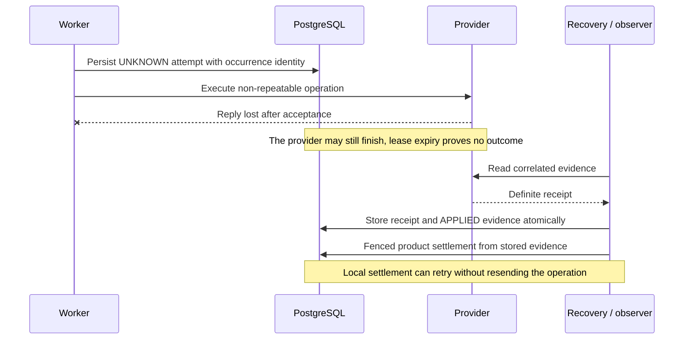

# Architecture and guarantees

For the application-level decision, start with [When Due is the right tool](https://github.com/gigaverse-app/due/blob/main/docs/why-due.md).
This reference describes the mechanisms and their exact boundaries.

PostgreSQL records an obligation, not just a request to enqueue a task. An
obligation can survive many execution attempts. Completion means both the
external result and the required local settlement have been handled according
to the application's declared policy.

## The path from acceptance to completion

```text
 REQUEST                     POSTGRESQL                          WORKER
    |                            |                                 |
    |-- atomic product + work -->|                                 |
    |<-------- COMMIT -----------|                                 |
    |                            |                                 |
    +-- post-commit nudge --------+---- Celery message ------------->|
                 may be lost     |                                 |
                                 |<-- recurring recovery selects --|
                                 |--- reserve delivery / claim --->|
                                 |                                 |-- external I/O
                                 |<--- fenced local settlement ----|
                                 |     product + work + handoffs    |
```

The bottom path must work when the nudge never arrives. A queue message points
to an obligation; PostgreSQL remains the authority for whether work is owed.
The worker's external call runs outside the transaction, so database locks do
not provide ordering at the provider.

## The work-table boundary

An application owns a product model and a concrete work model derived from Due's
abstract base. `capability.atomic(owner_id)` locks the owner, admits the captured
input, and commits with the product update. The post-commit wakeup is an
acceleration. A recurring recovery pass is required even when it rarely finds work.

The library owns claims, delivery reservations, lease expiry, revision fencing,
retry bookkeeping, evidence transitions and bounded recovery. The application
owns desired inputs, permission to call its external systems, and the meaning of
success. All local settlement callbacks run in the fenced transaction. They may
write product state and admit follow-up obligations, but must not perform I/O.

The first release is deliberately Django-backed. A framework-neutral PostgreSQL
adapter would need to prove the same transaction, lock ordering, evidence and
settlement semantics. It is not currently implemented or promised.

## Choose the capability

| Requirement | API | External contract |
| --- | --- | --- |
| Repeatable captured input | `ReplaySafeEffect` | Replaying the operation is safe |
| Several explicitly guarded calls | `OwnedDurableWorkCapability` | Every crossing has a declared replay policy |
| Mutable external state | `Projection` / `DurableProjection` | Application declares stale-write repair policy |
| Movable or cancelled deadline | `ScheduledAction` / `DurableScheduledAction` | Eligibility is rechecked before the effect |
| Non-repeatable occurrence | `DurableExternalOperation` | UNKNOWN blocks resend; exact evidence settles it |
| Observation of an uncertain occurrence | `ObservedExternalOperation` | Observation correlates with the original occurrence |
| Independent cleanup after a crossing | `IndependentCompensation` | Cleanup has its own persisted obligation |

Ordinary authoring imports live in `due.django.public`; specialized capabilities
live in `due.django.capabilities`. `due.errors`, `due.observations`, and
`due.retry_delays` do not load Django's model registry. Importing `due` alone has
no Django setup requirement. No native-table composition APIs ship in this release.
The private delivery helper exists only to support work-table observation workers.

## Ownership and external uncertainty

A queue message carries a registration name, row id and captured token. The
worker may not adopt the token currently stored on a refreshed row. Only the
captured token and revision can settle the work, and expiry rejects stale writes.
Ownership also gets checked immediately before external calls, outside the DB
transaction. Configure provider timeouts below the worker soft limit, soft below
hard, and hard below the lease.

A local fence does not cancel remote I/O. A timeout can mean the provider accepted
the operation but lost the reply. Evidence-required operations commit an UNKNOWN
attempt before crossing that boundary. They never infer nonapplication from lease
expiry. A correlated positive receipt is persisted before local publication, so
recovery can finish settlement without repeating the external effect. A definite
negative receipt carries its rejection/retry decision atomically. Contradictory
receipts are rejected.

Projection and scheduled-action repair are explicit application policies. A bounded
repair window is not proof that an earlier request completed. Keep provider
idempotency keys stable across retries and distinct across requested revisions.
Due's key includes the immutable admission identity as well as the revision.
An application whose provider target is permanently gone (a deleted channel, a
purged bucket) can settle an attempt's repair as `RepairSettledBy.TARGET_RETIRED`:
no receipt can arrive, the outcome stays UNKNOWN evidence, and neither the repair
window nor attempt pruning touches it. A projection does this from
`write_projection` with `retire_escaped_writes(work)`, and only on definitive
provider evidence that the target is gone, never on an outage or elapsed time. It
settles older revisions only: the current revision is still owed to its target.

### An unknown outcome needs evidence



An inconclusive observation leaves the obligation unresolved. A definite
NOT_APPLIED result can authorize the capability's retry policy; a timeout alone
cannot. This distinction is what the evidence-required mode adds beyond safely
replaying an idempotent file write.

## Recovery and retries

READY and RETRYABLE rows become eligible by time and any declared execution gate.
QUEUED rows reserve delivery; lost reservations recover without spending the
failure budget. Expired CLAIMED executions consume their declared recovery/retry
policy. UNKNOWN work remains discoverable for evidence and operator attention;
it is not blindly replayed. EXHAUSTED and TERMINAL_FAILED remain visibly stopped.
An explicit authorized rearm is different from an identical producer request.
For replay-safe work, `request_work(..., retry_stopped=True)` explicitly rearms
unchanged stopped input under the admission lock: it resets the failure budget
and rotates the claim token while retaining the desired revision and all attempt
evidence. Changed input still starts a new revision. This prevents an identical
projection retry from turning its own uncertain writes into stale-revision debt;
the retained evidence still protects later input changes. Provider occurrences
must reconcile evidence instead and cannot use this option.

Each recovery phase isolates per-identity failures and continues other work, then
raises a grouped failure. Poisoned identities receive bounded backoff so they
cannot monopolize the first page. Soft worker limits and unusable database
transactions end the tick. Applications can also declare fatal recovery error
types through [startup hooks](integration.md#a-bad-row-is-different-from-a-broken-process). Telemetry failure cannot roll back product truth.
Prometheus metrics use the `due_` prefix, including backlog, recovery outcomes,
deferred identities and recovery heartbeat/staleness. Applications own alert
thresholds and exporting the registry; Sentry reporting is inert unless configured.

Retention prunes only successful work allowed by its policy. Evidence-required
occurrences retain their identity and evidence. Product callbacks must commit any
new obligation beside the state that owes it; a successful attempt alone does
not establish that a whole application workflow is finished.

## Verification integration

Work-table adopters declare `EffectExamples` through `effect_contract_suite`.
[The conformance guide](conformance.md) describes generated guarantees and
[the replacement audit](backend-adoption.md) separates standalone parity from
application migration. Shared fault oracles belong to pytest-obligation; Due owns
the binding to its registered capability, PostgreSQL state and Celery workers.

### Transient deadline hints

Registered `DurableWorkCapability` subclasses, including `ReplaySafeEffect` and
`ScheduledAction`, can opt into transient Celery ETA hints with `deadline_wakeup_horizon: ClassVar[timedelta | None]` (default `None`,
maximum five minutes). Recovery reads one bounded page of future `available_at`
values in that horizon, after ordinary due dispatch. Admission also publishes a
hint when within the horizon. After a successful attempt commits, the same
read-only path publishes the next future deadline from the existing row, including
a `ContinueAfter` continuation. Publication failure cannot undo settlement or
consume retry budget. None of these paths creates SQL hint rows or claims future
work; hints add reads and broker messages, not a persisted timer ledger. The window bounds timer distance, not total broker memory under arbitrary
submission/reschedule volume; duplicate hints can occur on successive sweeps.

A hint carries the work ID, revision and eligibility timestamp. Its task checks
current DB eligibility and then enters the normal atomic claim and fenced worker
path; it cannot shorten retry backoff or authorize an old revision. Timer loss,
queue delay, stale hints and lookahead overflow leave ordinary periodic recovery
as the liveness owner. Hint failures are isolated and reported, but never create
persisted recovery deferrals. Optional timer transport is not durable truth.

The [scheduled publication example](https://github.com/gigaverse-app/due/blob/main/examples/scheduled/README.md#deadline-hints-and-retry-safe-submission)
also demonstrates caller submission identity on its existing product row. That
application-level unique key protects initial admission, independently of Due's
work revision and provider idempotency identity.

The [Widget Store example](https://github.com/gigaverse-app/due/tree/main/examples/widget_store)
uses this option for ten timed dispatch stages on one obligation row. Its generated
process-death histories also use `WorkTableDelivery(..., lost_tasks=(wake_scheduled_work_task,))`
to discard every optional timer while keeping ordinary recovery delivery live.
The task retains its original scheduled-work name for queued-message compatibility.

### PostgreSQL-only transitions

`DatabaseEffect.transition(work)` runs under the current work fence, with the
canonical owner locked before the work row. The callback and its continuation
or final settlement commit together. A crash before commit rolls both back;
a crash after commit leaves one persisted deadline for normal recovery. A
redelivered token cannot repeat the committed callback. The callback's `work.owner`
is the locked canonical owner, so an adopter need not query and lock it again.

Return `ContinueAfter(delay, until=...)` for another short transition, or a result
for completion. Compose using the existing admission, eligibility and dependent
wake APIs. This adds no workflow interpreter, per-step journal or tables. Claim
and settlement still write the existing obligation row; it is not zero-write
execution.

Use this mode only for short writes on Due's PostgreSQL connection. Do not call
providers, sleep, mutate the work's fence, or write through another database
connection inside it. The guarded external-call API refuses this transaction,
but arbitrary socket calls cannot be intercepted. Provider-backed books,
projections and scheduled publication retain their existing external-effect modes.

Generated contracts for this mode require `delivery_replays`, separately labelled
from profile H's raw external-effect replay. `EffectExamples.completions` binds
explicit terminal outcomes with a simulated time bound. The shared oracles live
in pytest-obligation; Due only supplies its real task bodies, clock and registered
recovery cadence. Lost hints remain recoverable without a second protocol.


### Recovery step ownership

`RecoveryStep.key` identifies a loop independently from its metrics phase.
Defaults preserve the existing single-loop API and empty-key deferral rows.
Named steps isolate selection, success release, candidate removal and injected
faults by (effect, phase, step, identity). Phase counters aggregate their results;
step keys are not unbounded metric labels. Conformance generates one product
history per custom step key and validates the actual factory inputs.

Migration `due.0003_recoverydeferral_step` preserves existing holds and supplies
a database default for older writers. Apply migrations before new processes.
Old workers do not understand named holds; during a mixed-version rollout they
can retry early, but holds are advisory and owed work stays in product rows.
A schema rollback coalesces duplicate holds conservatively before restoring
the old unique constraint. No obligation, receipt or work row is removed.
