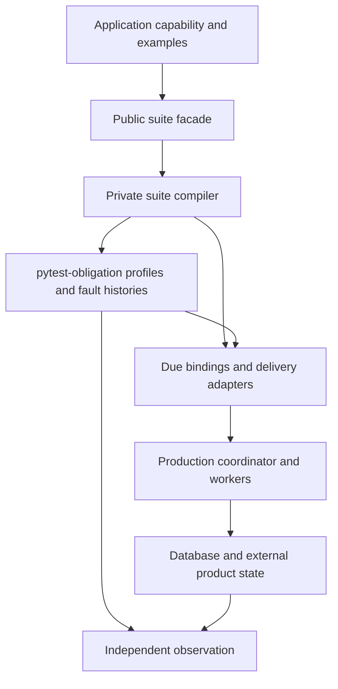

# Conformance API and module boundaries

Start with the [authoring walkthrough](conformance.md). This reference describes
what applications supply, what the harness owns, and where to extend it.
All paths below are relative to `due.django.conformance`. Due is alpha; these are
the intended public imports, not a promise of API stability before 1.0.

## Public imports

| Module | Interface and responsibility |
| --- | --- |
| [`suite`](../src/due/django/conformance/suite.py) | `effect_contract_suite` enrolls a pytest class; `effect_contract` builds a shared `ObligationContract` for advanced composition. Existing example-type imports remain supported. |
| [`examples`](../src/due/django/conformance/examples.py) | `EffectExamples` and the delivery, retry, terminal, eligibility, rejection and discovery declarations below. |
| [`provider`](../src/due/django/conformance/provider.py) | `ProviderProbe`: typed real-call observation, per-identity counters and scoped before/after provider faults. |
| [`recovery_steps`](../src/due/django/conformance/recovery_steps.py) | `RecoveryStepExample`: product facts for paged steps; `RecoveryStepBinding` and `poison_recovery_call` for custom loops. |
| [`binding`](../src/due/django/conformance/binding.py) | `Binding[T]`: a zero-argument factory returning `T` or a context manager yielding `T`. |
| [`host`](../src/due/django/conformance/host.py) | `work_table_host` connects the shared proof engine to Django, PostgreSQL and Celery. Configure after Django setup. |
| [`delivery`](../src/due/django/conformance/delivery.py) | `WorkTableDelivery` drives bounded recovery for shared handoff histories. |
| [`scenarios`](../src/due/django/conformance/scenarios.py) | `ProducerExample`, `AdmissionFailureExample`, `SynchronousCallerExample`, `WakeExample`: product command boundaries. |
| [`composition`](../src/due/django/conformance/composition.py) | `SupersessionExample`, `ProjectionExample`, `CancellationExample`, `CompensationExample`: changing intent and independent cleanup. |
| [`observations`](../src/due/django/conformance/observations.py) | `ObservationExample`, `observation_handoff`: read-only evidence resolves uncertain operations without resending. |
| [`enrollment`](../src/due/django/conformance/enrollment.py) | `assert_complete_enrollment`: compare collected suites with an independent production capability manifest. |
| [`reporting`](../src/due/django/conformance/reporting.py) | Optional pytest plugin producing effect and observation reports. |

Advanced adapters are public for custom proofs and application journey tests:

| Module | Use it when |
| --- | --- |
| [`bindings`](../src/due/django/conformance/bindings.py) | Building shared profile bindings directly through `DurableWorkBindings`. Prefer suite enrollment for ordinary adopters. |
| [`background`](../src/due/django/conformance/background.py) | Holding/dropping notifications, draining real task bodies, freezing scheduler time and accounting for expected worker failures. |
| [`background_beat`](../src/due/django/conformance/background_beat.py) | Driving selected installed Beat entries with `run_beat`, `tick` and `beat_entries_for`. This does not simulate the Beat daemon. |
| [`interleavings`](../src/due/django/conformance/interleavings.py) | Binding shared ordered actors to Due through `BrokerControl`, `environment` and `connection_scope`. The shared harness owns schedule generation. |
| [`registrations`](../src/due/django/conformance/registrations.py) | Temporarily installing real registrations in tests with `durable_work_installed`. |
| [`database`](../src/due/django/conformance/database.py) | Testing work-table database behavior or keeping an older transaction open for realistic visibility/scale proofs. |

Individual assertion functions already exported by `suite` remain available for
custom proofs. `fact_bindings`, `retry_bindings`, `snapshot_bindings`,
`eligibility_binding`, `projection_retention` and `operation_ambiguity` convert
application examples into the shared profile contracts. `required_examples_for`
reports the mode's base requirements; enrollment also checks policy-dependent
requirements. `failing_external_call(path)` scopes a real dependency failure.
Standalone proof calls do not automatically enroll a capability or establish
complete coverage.

## Example contracts

| Declaration | Required meaning |
| --- | --- |
| `DeliveryExample(work, observe, expected, effect_calls=None, checkpoint=None)` | `work` was admitted by the real producer. `observe()` reads product/provider state; `expected` states what is owed. `effect_calls()` counts real boundary entries where replay evidence is needed. `checkpoint=CheckpointedReplay(because, applied)` declares an effect that records each accepted provider call and skips it on replay ([lost acknowledgements](conformance.md#lost-acknowledgements)). |
| `FailureExample(attempts, prepare=...)` | `attempts(work)` counts actual attempts, using persisted evidence or an independent provider counter. Optional `prepare(work)` arranges the failure; the runner owns retry execution. |
| `TerminalExample(observe=..., rearm=...)` | Product-visible exhaustion and the authorized rearm command. Supply exactly one of `rearm` or a substantive `no_rearm_because`. |
| `EligibilityExample(delivery, make_eligible, recovery_timeout=...)` | Initially blocked intent; `make_eligible` is a real production readiness transition. Default recovery horizon is five minutes. |
| `RejectionExample(delivery, disposition, expected_attempts=1)` | A provider rejection, its retry/terminal disposition and the expected persisted attempt count after recovery. |
| `FactExamples(...)` | `make_implied`, `move`, `make_stopped` arrange canonical product facts; `desired(work)` observes the derived target. `identity_after_move` describes an identity change. Never recreate the discovery query. |
| `ObservationExample(delivery=..., reveal=..., observation_calls=...)` | Begin with a lost create response; reveal a canonical provider receipt and count actual read-only observation calls. |
| `SupersessionExample(work=..., change=..., observe=...)` | Change desired inputs through a real command and observe the result. `ProjectionExample.latest` adds the latest target; `CancellationExample.completed` identifies the externally completed outcome. |
| `CompensationExample(...)` | A producer work row, the provider seam, late output, the retirement command and an independent `observe()`/`clean` oracle for cleanup. |

The [source declarations for command examples](../src/due/django/conformance/scenarios.py)
document `ProducerExample`, `AdmissionFailureExample.after_save` and
`SynchronousCallerExample`; the [document adopter](https://github.com/gigaverse-app/due/blob/main/integration_tests/conformance/document_examples.py)
shows real producer and partial-admission bindings.

## Every `EffectExamples` field

These fields are evidence, not alternative runtime implementations. A missing
optional binding can mean **NotAssessed**, or a declaration error when the
capability requires it. Use the generated report to see the actual assessment;
`None` is never a claim that a guarantee passed.

| Fields | What the application supplies |
| --- | --- |
| `make_work`, `delivery`, `retry` | Required fresh producer admission, independent outcome and failing-provider scope. |
| `terminal` | Exhaustion visibility and authorized rearm for finite retry budgets. |
| `replay` | Shared `ReplaySafeEffect` binding that actually enters the external operation twice. |
| `eligibility` | One gate example or a mapping of named variants; keep readiness transitions in production. |
| `immutable_inputs`, `perturb_inputs`, `convergence_not_assessed`, `snapshot` | [Prove fixed inputs by perturbing product facts and revisiting admission](conformance.md#prove-an-immutable-input-declaration), record missing E evidence, or exercise real supersession. |
| `derivation` | Canonical fact arrangement and independent desired-state observation. |
| `recovery_steps` | Every custom callback returned by `derivation_steps()` or `recorded_work_steps()`, keyed by its phase; see the executable coverage contract below. |
| `discovery_edges` | Related rows the discovery reads, by family name, as `EdgeFamily(model=..., edge_row=owner -> row)`; their database-legal edge values get the discovery admissibility cases. |
| `applied_receipt`, `receipt_repair` | A canonical applied receipt and a scoped delivery proving recovery repairs product state without repeating the effect. |
| `evidence_entry` | Optional, operations only: the application's production entry point for a late receipt (a webhook handler or reconciliation command), called with the work and `applied_receipt(work)`. When bound, profile C's late-evidence invariants deliver the receipt through it and settle through registered recovery, instead of the library's evidence recorder. An entry point that drops or misroutes the receipt, or writes the product without recording evidence, leaves the ambiguity unresolved and fails. [Self-test](../tests/conformance/test_evidence_entry_point.py). |
| `producers`, `admissions`, `admission_failures` | Named producer/standalone command paths and an interruption after a partial write. These bindings own their scopes. |
| `admission_not_applicable` | A substantive reason there is no partial admission state to roll back; product-plus-work writes require failure evidence. |
| `synchronous_callers` | Named request paths that admit and attempt inline; each binding owns its scope. Seven histories run per caller: inline, enclosing commit and rollback, effect failure, a claim already held by another worker, a repeat of the same value (`repeat=`, default `call`), and a lost response after the provider accepted (`lose_response=`, required). A strict caller may report the held claim as `WorkIncomplete` or as its own error raised from it (the cause/context chain is followed; `from None` detaches it). [Self-test](../tests/conformance/test_synchronous_caller_scenario.py). |
| `wake_commands` | Named commands that commit new facts for existing work and call the capability's `wake()` (`WakeExample`). Generated for READY, claimed and settled work with the wake's notification lost: the work keeps its retry budget, keeps its revision unless a claimed pass must be fenced, and recovery settles it once from the new facts. Not for evidence-required operations or compensations. [Self-test](../tests/conformance/test_wake_command_histories.py). |
| `rejections` | The provider outcome matrix: each named rejection, its intended `RETRYABLE`/`TERMINAL` disposition and product outcome. Any mode; an operation's evidence recovery must also preserve the decision. |
| `uncertainties` | Named ambiguous outcomes of an external operation; evidence recovery must preserve their meaning. |
| `observation` | Read-only reconciliation of an uncertain external operation. |
| `identity_of` | Stable canonical identity for comparing obligations across generated cases. |
| `in_flight`, `evidence_confluence` | Named shared `Scenario` bindings for concurrent work and conflicting evidence. |
| `convergence`, `convergence_families` | Production result-application binding and explicit `NotApplicable` reasons for individual convergence families. Omitted families remain unassessed. |
| `compensation` | The independent cleanup relationship and its product oracle. |
| `handoffs`, `process_handoffs` | Shared `HandoffHistory` declarations and real child-process histories. Process histories own child initialization. |
| `environment`, `fixtures` | Outer context for ordinary examples, plus pytest fixture names used by generated cases. Provider resources must survive final observation. |

## Executable recovery coverage

For ordinary per-item cleanup, declare the query and action once in production:

```python
def derivation_steps(self):
    return (
        *super().derivation_steps(),
        RecoveryStep.paged(
            RecoveryPhase.DISCOVERY,
            self.orphan_ids,  # Ordered, unsliced identity queryset.
            self.clean_one,  # Product transition; owns its transaction/recheck.
            size=self.policy.batch_size,
        ),
    )
```

The adopter test supplies only product facts:

```python
from due.django.conformance.recovery_steps import RecoveryStepExample


def orphan_example():
    return RecoveryStepExample(
        make_pending=create_orphan,  # Real admission followed by source deletion.
        pending=orphan_still_owes_cleanup,
    )


examples = EffectExamples(
    # ...ordinary delivery/retry/product bindings...
    recovery_steps={RecoveryPhase.DISCOVERY: orphan_example},
)
```

Due owns the loop, fair paging, fault seam and retry clock. There is no repeated
`run=` declaration or manual monkeypatch. Unchanged library steps require no
additional example. The action may be a function, bound method or fresh lambda.

Give an extra loop a stable `key="withdraw_orphans"` when it shares a phase
with another loop; map `"withdraw_orphans"` to its product example. A key is
persistent retry identity, not a metric label. Omit it for the existing single
loop per phase. Duplicate keys fail before any step runs. Phases can now describe
what the work actually does: two DISCOVERY loops need no misleading OBSERVATION
label, and cannot release each other's holds. Renaming a key starts a new retry
namespace; it never changes the product obligation.

The library factory uses explicit immutable bindings for its model, policy,
retention and evidence behavior. Only the exact library implementation with the
current adopter's inputs inherits a library proof; matching function bytecode,
names or wrapper metadata does not establish coverage.

An adopter's `_reap` or `_dispatch` override automatically runs the corresponding
shared history without a declaration. An override that skips its fault seam fails.

The default fault occurs before the action. If an action writes before a later
operation can fail, supply `poison=...` at that later boundary to prove the write
rolls back and the obligation remains selectable. The default paging check cannot
establish transaction atomicity inside the action.

For a genuinely custom loop, use
`RecoveryStepBinding(run=capability.callback, example=...)` and a
`RecoveryStepExample`. The default fault intercepts `RecoveryPass.run_page`;
for another per-row boundary, set `poison=` with `poison_recovery_call` or
obligation's `poison_many`. Only these custom loops repeat their exact callback;
another receiver, wrapper or phase label cannot borrow coverage.

Due discovers the actual executable steps. Obligation validates their bindings,
checks required collected cases and owns the shared fault history. Every failed
candidate must actually reach the fault seam. A full failing page must leave
healthy work behind it reachable within two ticks; each tick encountering faults
must report them and preserve the failed work. Due additionally checks persisted
holds and no premature retry. Once the fault and holds end, the same production
recovery must progress every failed identity. A separate healthy control uses
the same product example without faults.

Collection revalidates the runtime inventory and rejects missing, stale or
incorrect declarations and removed generated cases. Product examples must create
independent identities and observe actual obligations; neither the runtime nor
the harness can infer a product effect that was never declared.

## Ownership and dependency direction

```text
Application tests                     Public authoring API
  production capability -----------> suite.effect_contract_suite
  example factories ---------------> examples.EffectExamples
  provider/resource scopes --------> binding.Binding
                                             |
                                             v
                                 _internal/suite.py
                                  /              \
                     shared profile proofs    Due-specific assertions
                              |                      |
                     pytest-obligation        bindings / delivery
                              \                      /
                               real Due runtime + DB
                                         |
                                  product observation
```



`examples.py` owns declarations; `suite.py` is an explicit facade over the single
compiler in [`_internal/suite.py`](../src/due/django/conformance/_internal/suite.py).
Do not import `_internal` from application tests. Helpers such as collection,
source-location and report-merge machinery are contributor implementation;
extend through the public declarations and pytest plugin instead. The package
root stays lazy so pytest can load reporting before Django initializes models.

When changing a proof, keep the production transition in its runtime owner and
the portable oracle in pytest-obligation. Add a faulty control that the proof
rejects, then run the [contributor checks](https://github.com/gigaverse-app/due/blob/main/CONTRIBUTING.md). Reports deliberately
link to the actual proof implementation, even when users import its public facade.

Crash histories also enter `EffectExamples.environment` before `arrange` and keep it active through transition, delivery, recovery and observation. Each history run owns and closes its scope, including faulted runs. Process histories configure their own child-process environment.

Schema index proofs reuse pytest-obligation's PostgreSQL catalog records, including key order, included columns and partial predicates. They reject a B-tree condition on only a later key; an index name or `Index Cond` alone is insufficient evidence of narrowing.

## Derive routine bindings from one provider seam

`seams.ProviderSeam` names the provider environment, real admission, independent
observed/expected outcomes and call counters. `seam_examples(capability, seam,
**overrides)` derives delivery, bounded or persistent retry, supported replay and projection
convergence bindings. It never replaces the coordinator with test code.

| Interface | Meaning |
| --- | --- |
| `environment`, `make_work`, `arrange` | Enter the provider fake, admit through production, optionally script the provider after admission |
| `observe`, `delivered` | Independent observed and reviewed expected outcomes |
| `calls`, `calls_for`, `provider_state`, `provider_expected` | Count actual provider entries; optionally correlate by work identity and observe provider state independently of settlement; a distinct provider observation requires its independent expected outcome |
| `refuse` | Configure rejection in place or return a context manager kept active through every retry; required, since every policy derives `retry` from it |
| `outcome`, `rejection` | Scoped outcome/rejection factories with optional admission and observation overrides |
| `producer`, `caller`, `interrupted` | Bind real admission, inline attempts and interruption after a persisted work row |
| `replay`, `convergence` | Reuse the capability's effect method and result application |

Keep producers, gates, derivation facts, uncertainty matrices and distinct
histories explicit. Overrides replace defaults. The declaration requires the same
ARRANGE / REAL PRODUCTION / EXTERNAL SEAM / OBSERVE annotations as handwritten
bindings. Root controls reject constant observations, dead call counters and
refusals that never fail: [executable examples](../tests/conformance/test_provider_seam.py).

The shipped applications now use these derived bindings: [books](https://github.com/gigaverse-app/due/blob/main/integration_tests/conformance/book_examples.py),
[catalog](https://github.com/gigaverse-app/due/blob/main/integration_tests/conformance/catalog_examples.py), [documents](https://github.com/gigaverse-app/due/blob/main/integration_tests/conformance/document_examples.py),
[scheduled publication](https://github.com/gigaverse-app/due/blob/main/integration_tests/conformance/scheduled_examples.py), and
[print orders](https://github.com/gigaverse-app/due/blob/main/integration_tests/conformance/order_examples.py). They retain their explicit
producer, terminal, admission-interruption and process-death histories.

`outcome` and `rejection` keep a context manager returned by their script active
through execution and observation. This is how the order application composes
`ProviderProbe.reject()` and reply loss after a real printer submission. Provider
and fault cleanup cannot swallow a proof's assertion. The real book application
has a [positive/mutation control](https://github.com/gigaverse-app/due/blob/main/integration_tests/conformance/test_application_binding_scopes.py)
that wraps its SQLite provider in such defective cleanup: the working indexer
passes, while a worker that settles a fabricated index key still fails.

`ProviderProbe` and `ProviderSeam` have different jobs: the probe observes and
faults a synchronous provider callable; the seam describes an adopter and derives
its conformance bindings. A seam may use a probe as its provider handle.

`EffectExamples.retry` is required for every policy, and the policy decides which
half of profile J it drives. A bounded policy (`max_rearms`) binds it to
`BoundedRetry` and also requires `terminal`: failing work must exhaust at exactly
its budget and stay terminal. An unbounded policy (`max_rearms=None`) binds the
same failure example to `PersistentRetry`: through six failing executions the work
must reach the provider once each, never become terminal, stay out of due work
until its retry delay elapses (a zero delay makes the next due pass the retry),
and be due again afterwards. A missing retry binding is a declaration error, not
unassessed evidence. [Runtime self-test](../tests/conformance/test_persistent_retry.py).

`interleavings.WorkTableRecovery` runs registered recovery for a tuple of models
and accounts only for worker errors explained by the bound `ProviderControl`.
It reuses the background driver and registration manifest.
Its `session(...)` method supplies the normal work-table bindings: captured
admission, delivery start, broker loss/redelivery, registered recovery, clock,
fault accounting, refreshed desired/applied revisions, and retention of active
work or UNKNOWN evidence from any revision. Supply `intents`, the real `admit`
command and an independent `observe`; add `change` for mutable projections.
This returns the canonical pytest-obligation `InFlightSession`.

```python
recovery = WorkTableRecovery(background, provider, (MyWork,), (TimeoutError,))
yield recovery.session(
    intents=intents,
    admit=create_document,
    observe=read_product_and_provider,
    change=edit_document,
)
```

Declare the matching `InFlightConvergence` in `EffectExamples.in_flight` with
`transport=True`; keep independent-progress and provider-lifetime choices
explicit. For a restorable authority, supply `retire`, the reviewed `retired`
observation and `recreate(old_work, value) -> current_work`, then declare
`retirement=True, recreation=True`. The shared suite adds old-completion-after-
restoration histories and Hypothesis lifecycle exploration automatically.
For a **synchronous** retirement that can reject, also bind `authority` (an
immutable product snapshot), `rejection_errors`, and the declaration's
`rejected_retirement_seams`. Asynchronous admission does not claim synchronous
rollback coverage. These are application semantics; Due cannot infer them from
a work model.

Use `retained=` only when recovery ownership passes to a different row. Use the
underlying `InFlightSession` for other nonstandard lifecycles. Neither API
implements another scheduler or a runtime batch mode.


Unbounded discovery generates `test_discovery_selection_is_complete`. It compares
the production candidate query with the real per-owner derivation, so an owner
that derivation would enroll cannot silently disappear from recovery. Discovery
with an explicit horizon does not claim to cover every possible owner and does
not receive this check. The [shared proof's scope and limits](https://github.com/gigaverse-app/pytest-obligation/blob/main/package/docs/selection-completeness.md)
apply; the generated case participates in normal collection and outcome guards.

Discovery also generates two admissibility cases per database-legal edge value
(`test_database_legal_candidate_is_admissible[...]`,
`test_inadmissible_candidate_does_not_block_the_next[...]`). Each case writes the
value into a valid implied owner without model validation, the way legacy rows
get it, and requires production `derive()` to admit or exclude that row without
stalling the owner behind it. Owner fields are always covered. A discovery that
also reads a related row, such as a parent's scope that the candidate query joins
or a tenant that `desired_for` copies, declares it:

```python
EffectExamples(
    ...,
    derivation=derivation_facts,
    discovery_edges={"parent": EdgeFamily(model=Parent, edge_row=lambda owner: owner.parent)},
)
```

The related row's edges are collected as `[parent-<field>-<kind>]`. `make_implied`
must create a distinct related row per owner, or the liveness case refuses to run:
poisoning a shared parent would poison both owners.

`process_handoffs` requires an independent `ProcessHistory.expected` value or input-derived callback for every entry. Omitted expectations raise at binding construction; plain pytest-obligation convergence-only histories remain available outside this application binding.


## Existing lifecycle delivery

`due.django.conformance.delivery.SweepDelivery(binding, scope=..., app=...)`
accepts a context-managed `DueWorkSweep` and an optional application registration
scope. Its `scoped(history)` reuses the arranged sweep rather than creating a
second provider environment. Nested histories and failures restore the prior
binding. `rounds` and `round_delay` bound recovery; `recover_with(ticks)` also
executes explicitly declared downstream sweeps. Work-table and existing-lifecycle
delivery share one broker-accounted recovery loop, including delayed deliveries
and refusal to certify a history while scheduled work remains.

`effective_registrations(iterable)` in `conformance.registrations` shares the
ordered test-overlay rule: later names or models replace earlier registrations.
Application adapters that preserve a live manifest's identity can use this
selection before the runtime's normal registration validation. Most standalone
tests should use `durable_work_installed()` directly.

Generated replay contracts require `expected` before executing any proof. A
`ProviderSeam` reuses `delivered` when replay observes the same result; with a
separate `provider_state`, supply `provider_expected` explicitly. This prevents
settled product state from standing in for an external replay result.

For create-only commands, `ProducerExample.revisit(works)` binds a real command
on the originally admitted owners for the immutable-input proof. It receives
the originally returned work rows, must enter their capability transactions,
and may not write the test's desired work state itself. See the
[books binding](https://github.com/gigaverse-app/due/blob/main/integration_tests/conformance/book_examples.py) and
[mutation controls](https://github.com/gigaverse-app/due/blob/main/integration_tests/conformance/test_books_contract_controls.py).

## Terminal completion and database delivery

`EffectExamples.completions` contains named bindings for pytest-obligation's
`BoundedCompletion`: a required terminal product outcome, controlled clock,
recovery and explicit time bounds. `due.django.conformance.completion.completion`
provides the production task/scheduler wiring, observes registered cadence, and
can discard every optional timer hint. A minimum wait catches skipped business
delays; an independent remaining-progress observer catches reversal. See the
Widget Store and books bindings for complete workflows.

`DatabaseEffect` requires `delivery_replays`. Bind the repeated token and counted
application callback with `due.django.conformance.database_replay.database_replay`.
It generates a separately named delivery proof and deliberately leaves profile H
not applicable: the raw transactional callback is not independently replay-safe.
External-effect modes retain their existing mandatory profile H bindings.

Both families are included in the collected expected-case set and effect report.
CI can require their full `test_due_work_contract[...]` IDs with
`check_adoption_report.py --required-effect-case`, so removing enrollment cannot
silently turn terminal correctness into a first-stage-only proof.

These new families require pytest-obligation 0.12 or later. During review, the
workspace pins the companion implementation; release that version before
publishing a Due distribution that includes these testing APIs.
