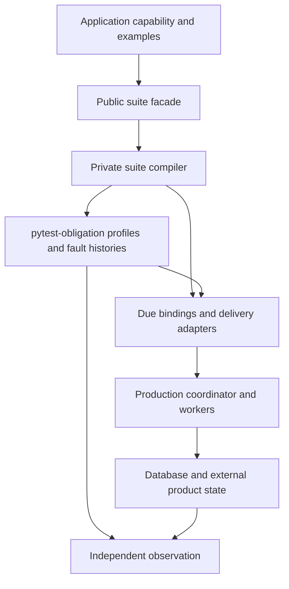

# Conformance API and module boundaries

Start with the [authoring walkthrough](conformance.md). This reference describes
what applications supply, what the harness owns, and where to extend it.
All paths below are relative to `due.django.conformance`. Due is alpha; these are
the intended public imports, not a promise of API stability before 1.0.

## Public imports

| Module | Interface and responsibility |
| --- | --- |
| [`suite`](../src/due/django/conformance/suite.py) | `effect_contract_suite` enrolls a pytest class; `effect_contract` builds a shared `ObligationContract` for advanced composition. Existing example-type imports remain supported. |
| [`examples`](../src/due/django/conformance/examples.py) | `EffectExamples` and the delivery, retry, terminal, eligibility, rejection and discovery declarations below. |
| [`binding`](../src/due/django/conformance/binding.py) | `Binding[T]`: a zero-argument factory returning `T` or a context manager yielding `T`. |
| [`host`](../src/due/django/conformance/host.py) | `work_table_host` connects the shared proof engine to Django, PostgreSQL and Celery. Configure after Django setup. |
| [`delivery`](../src/due/django/conformance/delivery.py) | `WorkTableDelivery` drives bounded recovery for shared handoff histories. |
| [`scenarios`](../src/due/django/conformance/scenarios.py) | `ProducerExample`, `AdmissionFailureExample`, `SynchronousCallerExample`: product command boundaries. |
| [`composition`](../src/due/django/conformance/composition.py) | `SupersessionExample`, `ProjectionExample`, `CancellationExample`, `CompensationExample`: changing intent and independent cleanup. |
| [`observations`](../src/due/django/conformance/observations.py) | `ObservationExample`, `observation_handoff`: read-only evidence resolves uncertain operations without resending. |
| [`enrollment`](../src/due/django/conformance/enrollment.py) | `assert_complete_enrollment`: compare collected suites with an independent production capability manifest. |
| [`reporting`](../src/due/django/conformance/reporting.py) | Optional pytest plugin producing effect and observation reports. |

Advanced adapters are public for custom proofs and application journey tests:

| Module | Use it when |
| --- | --- |
| [`bindings`](../src/due/django/conformance/bindings.py) | Building shared profile bindings directly through `DurableWorkBindings`. Prefer suite enrollment for ordinary adopters. |
| [`background`](../src/due/django/conformance/background.py) | Holding/dropping notifications, draining real task bodies, freezing scheduler time and accounting for expected worker failures. |
| [`background_beat`](../src/due/django/conformance/background_beat.py) | Driving selected installed Beat entries with `run_beat`, `tick` and `beat_entries_for`. This does not simulate the Beat daemon. |
| [`interleavings`](../src/due/django/conformance/interleavings.py) | Binding shared ordered actors to Due through `BrokerControl`, `environment` and `connection_scope`. The shared harness owns schedule generation. |
| [`registrations`](../src/due/django/conformance/registrations.py) | Temporarily installing real registrations in tests with `durable_work_installed`. |
| [`database`](../src/due/django/conformance/database.py) | Testing work-table database behavior or keeping an older transaction open for realistic visibility/scale proofs. |

Individual assertion functions already exported by `suite` remain available for
custom proofs. `fact_bindings`, `retry_bindings`, `snapshot_bindings`,
`eligibility_binding`, `projection_retention` and `operation_ambiguity` convert
application examples into the shared profile contracts. `required_examples_for`
reports the mode's base requirements; enrollment also checks policy-dependent
requirements. `failing_external_call(path)` scopes a real dependency failure.
Standalone proof calls do not automatically enroll a capability or establish
complete coverage.

## Example contracts

| Declaration | Required meaning |
| --- | --- |
| `DeliveryExample(work, observe, expected, effect_calls=None)` | `work` was admitted by the real producer. `observe()` reads product/provider state; `expected` states what is owed. `effect_calls()` counts real boundary entries where replay evidence is needed. |
| `FailureExample(attempts, prepare=...)` | `attempts(work)` counts actual attempts, using persisted evidence or an independent provider counter. Optional `prepare(work)` arranges the failure; the runner owns retry execution. |
| `TerminalExample(observe=..., rearm=...)` | Product-visible exhaustion and the authorized rearm command. Supply exactly one of `rearm` or a substantive `no_rearm_because`. |
| `EligibilityExample(delivery, make_eligible, recovery_timeout=...)` | Initially blocked intent; `make_eligible` is a real production readiness transition. Default recovery horizon is five minutes. |
| `RejectionExample(delivery, disposition, expected_attempts=1)` | A provider rejection, its retry/terminal disposition and the expected persisted attempt count after recovery. |
| `FactExamples(...)` | `make_implied`, `move`, `make_stopped` arrange canonical product facts; `desired(work)` observes the derived target. `identity_after_move` describes an identity change. Never recreate the discovery query. |
| `ObservationExample(delivery=..., reveal=..., observation_calls=...)` | Begin with a lost create response; reveal a canonical provider receipt and count actual read-only observation calls. |
| `SupersessionExample(work=..., change=..., observe=...)` | Change desired inputs through a real command and observe the result. `ProjectionExample.latest` adds the latest target; `CancellationExample.completed` identifies the externally completed outcome. |
| `CompensationExample(...)` | A producer work row, the provider seam, late output, the retirement command and an independent `observe()`/`clean` oracle for cleanup. |

The [source declarations for command examples](../src/due/django/conformance/scenarios.py)
document `ProducerExample`, `AdmissionFailureExample.after_save` and
`SynchronousCallerExample`; the [document adopter](../tests/conformance/document_examples.py)
shows real producer and partial-admission bindings.

## Every `EffectExamples` field

These fields are evidence, not alternative runtime implementations. A missing
optional binding can mean **NotAssessed**, or a declaration error when the
capability requires it. Use the generated report to see the actual assessment;
`None` is never a claim that a guarantee passed.

| Fields | What the application supplies |
| --- | --- |
| `make_work`, `delivery`, `retry` | Required fresh producer admission, independent outcome and failing-provider scope. |
| `terminal` | Exhaustion visibility and authorized rearm for finite retry budgets. |
| `replay` | Shared `ReplaySafeEffect` binding that actually enters the external operation twice. |
| `eligibility` | One gate example or a mapping of named variants; keep readiness transitions in production. |
| `immutable_inputs`, `perturb_inputs`, `convergence_not_assessed`, `snapshot` | [Prove fixed inputs by perturbing product facts and revisiting admission](conformance.md#prove-an-immutable-input-declaration), record missing E evidence, or exercise real supersession. |
| `derivation` | Canonical fact arrangement and independent desired-state observation. |
| `applied_receipt`, `receipt_repair` | A canonical applied receipt and a scoped delivery proving recovery repairs product state without repeating the effect. |
| `producers`, `admissions`, `admission_failures` | Named producer/standalone command paths and an interruption after a partial write. These bindings own their scopes. |
| `admission_not_applicable` | A substantive reason there is no partial admission state to roll back; product-plus-work writes require failure evidence. |
| `synchronous_callers` | Named request paths that admit and attempt inline; each binding owns its scope. |
| `rejections`, `uncertainties` | Named provider decisions and ambiguous outcomes; evidence recovery must preserve their meaning. |
| `observation` | Read-only reconciliation of an uncertain external operation. |
| `identity_of` | Stable canonical identity for comparing obligations across generated cases. |
| `in_flight`, `evidence_confluence` | Named shared `Scenario` bindings for concurrent work and conflicting evidence. |
| `convergence`, `convergence_families` | Production result-application binding and explicit `NotApplicable` reasons for individual convergence families. Omitted families remain unassessed. |
| `compensation` | The independent cleanup relationship and its product oracle. |
| `handoffs`, `process_handoffs` | Shared `HandoffHistory` declarations and real child-process histories. Process histories own child initialization. |
| `environment`, `fixtures` | Outer context for ordinary examples, plus pytest fixture names used by generated cases. Provider resources must survive final observation. |

## Ownership and dependency direction

```text
Application tests                     Public authoring API
  production capability -----------> suite.effect_contract_suite
  example factories ---------------> examples.EffectExamples
  provider/resource scopes --------> binding.Binding
                                             |
                                             v
                                 _internal/suite.py
                                  /              \
                     shared profile proofs    Due-specific assertions
                              |                      |
                     pytest-obligation        bindings / delivery
                              \                      /
                               real Due runtime + DB
                                         |
                                  product observation
```



`examples.py` owns declarations; `suite.py` is an explicit facade over the single
compiler in [`_internal/suite.py`](../src/due/django/conformance/_internal/suite.py).
Do not import `_internal` from application tests. Helpers such as collection,
source-location and report-merge machinery are contributor implementation;
extend through the public declarations and pytest plugin instead. The package
root stays lazy so pytest can load reporting before Django initializes models.

When changing a proof, keep the production transition in its runtime owner and
the portable oracle in pytest-obligation. Add a faulty control that the proof
rejects, then run the [contributor checks](../CONTRIBUTING.md). Reports deliberately
link to the actual proof implementation, even when users import its public facade.

Crash histories also enter `EffectExamples.environment` before `arrange` and keep it active through transition, delivery, recovery and observation. Each history run owns and closes its scope, including faulted runs. Process histories configure their own child-process environment.

Schema index proofs reuse pytest-obligation's PostgreSQL catalog records, including key order, included columns and partial predicates. They reject a B-tree condition on only a later key; an index name or `Index Cond` alone is insufficient evidence of narrowing.
