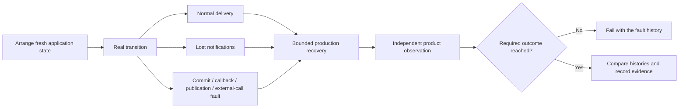
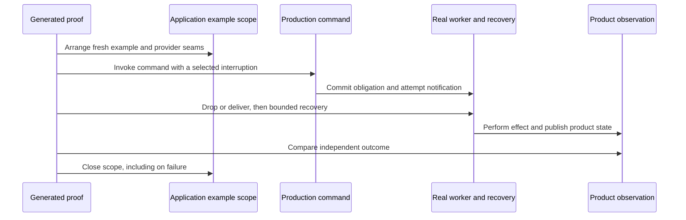
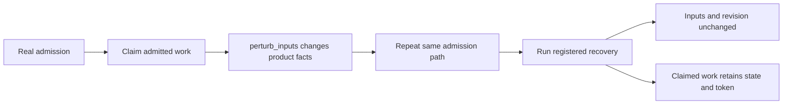

# Prove your application's work tables

Common application bindings and fault controls are available from
`due.django.conformance`: `EffectExamples`, `effect_contract_suite`,
`work_table_host`, `ProviderSeam`, `seam_examples`, `WorkTableDelivery`,
`hold_nudges`, `expire_lease`, `die_after`, and `WorkerDied`. Routine producer,
admission, supersession and terminal bindings, plus enrollment helpers, are
also exported there. Specialized declarations remain in the
modules listed below. See the [API map](api-guide.md#imports-you-actually-need).

**Always build this contract as you integrate Due.** The generated
pytest-obligation tests are a central reliability benefit and part of a complete
integration. Do not wait for an outage or a separate hardening project. Start with
the first native capability and extend its bindings as the product grows.

The deliberately trivial [native work lesson](native-work-tutorial.md) includes a complete
[binding](../../integration_tests/conformance/number_examples.py) and
[generated suite](../../integration_tests/conformance/test_number_contract.py).
Its hooks only sleep, multiply, print and save a result. Start there to see what
the contract asks of your application without a business workflow in the way.

The [Acme Printworks tutorial](../../docs/acme-printworks-tutorial.md) shows a small
application growing from Django Tasks to four native contracts. Its runnable
[test classes](../../examples/acme_printworks/tests/test_contracts.py) generate
policy-specific failure tests; the application supplies real producer commands,
external fault seams, and independent customer-visible observations. The
[enrollment check](../../examples/acme_printworks/tests/test_enrollment.py) also
proves that deleting a suite is rejected.

Install `django-due[testing]`. Enroll each production capability once with
`effect_contract_suite(capability, examples=EffectExamples(...))`. The capability's
actual mode, discovery, gate, retry and retention policies determine the required
proofs. Examples supply real commands, provider seams and independent product
observations; they do not implement selection, settlement or recovery.

The complete executable adopter is
[document_examples.py](https://github.com/gigaverse-app/due/blob/main/integration_tests/conformance/document_examples.py), enrolled in
[test_document_contract.py](https://github.com/gigaverse-app/due/blob/main/integration_tests/conformance/test_document_contract.py).
It writes real files and observes their contents through the published product
pointer. The replay proof enters the file writer twice and counts the actual
writes. Its failure examples interrupt real storage writes and partial command
admission.

## Who owns each part of a proof?

```text
 APPLICATION                    DUE                    PYTEST-OBLIGATION
 production capability --------> mode/policy ------------> required profiles
 real producer / provider seam -> runtime adapters ------> fault histories
 independent product observer --------------------------------> verdict
                                       |                        |
                         real DB + task bodies       shared invariant checks
                                       |                        |
                                       +----------+-------------+
                                                  |
                                  collected + executed evidence
```

Due does not maintain another copy of the semantic assertions. Its adapters bind
the shared proofs to real admission, claims, fences, recovery and evidence. Your
application supplies the product meaning that a generic runtime cannot infer.

## Configure the host

In the application's test configuration, after Django setup:

```python
from pytest_obligation import configure
from due.django.conformance.host import work_table_host

configure(work_table_host(production_packages={"myapp"}))
```

This binds PostgreSQL transactions, worker connections, clocks, commit and
callback failures, Celery publication failures, and the real Celery soft-limit
exception. Pass `replica_aliases` when the test database configuration does not
identify the application's replicas. Applications with a custom harness host can
compose pytest-obligation's public `django_host` directly.

If your application already has a tenant or request context, observe **that**
context so a leak cannot hide behind Due's separate context variable:

```python
configure(
    work_table_host(
        production_packages={"myapp"},
        replica_aliases={"replica"},
        ambient_context=my_application_current_tenant,
    )
)
```

The canonical Django host enrolls its ambient-context restoration proof. It
checks the value before and after the tick; per-row tenant correctness still
needs the application's own observation. The [host self-test](../tests/conformance/test_host.py)
includes a leaking tick and proves that the shared assertion rejects it.

Framework integrations that already rely on signals or hooks can also supply
`receiver_breaker=`. For existing Django signals, reuse
`pytest_obligation.integrations.django.receivers.django_receiver_breaker(signal)`;
for custom hooks, implement the public `ReceiverBreaker` protocol. This does not
recommend adding business side effects through signals. Without a supplied
breaker, receiver-failure coverage is not claimed.

Initialize the same Celery application, task imports, registry and Beat schedule
that workers use. The schedule proof checks both Django settings and the current
Celery app. A test-only schedule generator cannot substitute for installed
configuration. Applications that intentionally leave routing uninstalled during
tests can use `durable_work_installed(*registrations)`; the optional
`installed_durable_work` fixture requires an application-provided
`durable_work_registrations` fixture. Due never imports an application manifest.

## Declare the evidence your mode needs

Import declarations from `due.django.conformance.examples` and enroll through
`due.django.conformance.suite`. Existing type imports from `suite` remain supported.

| Capability feature | Application examples | Generated evidence |
| --- | --- | --- |
| Every work table | `make_work`, `delivery`, `retry` | Recovery, fencing, lock order, duplicate workers, lost notifications, poison isolation, indexes |
| Finite retry budget | `terminal` | Visible product failure and authorized rearm, or a reason rearm is forbidden |
| Classified provider outcomes (any mode) | `rejections` | Each named outcome takes its declared classification in one execution and shows it on the product; a terminal one is never selected or sent again (profile J `classified_failures`) |
| Provider-declared retry window | `RejectionExample(provider_wait=...)` or `ProviderSeam.rejection(..., provider_wait=...)` | Partial time advance keeps work ineligible; a stale delivery cannot call the provider or change the waiting state |
| Replay-safe effect | `replay`; `delivery.effect_calls` | An actual second external execution leaves the same observable result; a lost acknowledgement replays through recovery to one settled outcome |
| External operation | `applied_receipt`, `receipt_repair`, `rejections`, `uncertainties`; optional `evidence_entry` | UNKNOWN blocks resend; receipts repair publication through interruption histories; late evidence settles through the application's own receipt entry point when bound |
| Read-only observation | `observation` | Inconclusive evidence, lost/stale observation delivery, competing receipt, no resend |
| Projection or scheduled action | `snapshot` | Supersession; late projection repair or cancellation after external entry |
| Restorable authority | `in_flight` with `WorkTableRecovery.session`, real retirement/restoration commands | Generated late completion across retirement/restoration; optional Hypothesis lifecycle histories |
| Canonical discovery | `derivation` | Fact-derived obligations, admissible database edge values, poisoned candidates |
| Execution gate | `eligibility` (one or named variants) | Blocked intent, bounded inspection and periodic recovery |
| Custom recovery callback | `recovery_steps`, bound to each actual callback | [Faulted first-page progress, preserved work, backoff and retry](conformance-api.md#executable-recovery-coverage) |
| Independent compensation | `compensation` | Cleanup survives producer exhaustion and late completion |
| Product command | `producers`, `admissions`, `admission_failures` | Commit/rollback, lost wakeup, standalone partial-admission rollback |
| Inline caller | `synchronous_callers` | Recovery after request-path interruptions; a held claim is not bypassed; a repeated value admits nothing; a lost response is not blindly resent |
| Wake command | `wake_commands` | Woken READY, claimed or settled work re-reads the new facts once, and recovery covers a lost wake notification |
| Concurrent application changes | `in_flight`, `evidence_confluence`, `convergence` | pytest-obligation's shared interleaving and result-application proofs |
| Committed handoff | `handoffs` | Shared commit, callback, broker and external-call interruption histories |
| Actual process death | `process_handoffs` | Shared process-death oracle, with application-owned child entry points |

Use independent observations: product state, provider state, files, or real
boundary call counters. Work-row success alone cannot establish completion of
an application effect. Scoped examples may be context managers, keeping provider
seams alive through the final observation. `environment` scopes ordinary bindings;
producer/admission/inline examples own their scopes so they cannot accidentally
hide an early notification. Process histories own their child setup; fixtures
keep their external resources alive for the whole generated case.

`Binding` and `entered_binding` reuse `pytest_obligation.helpers`: plain values
and scoped examples have one entry contract. Cleanup still receives the original
exception, but cannot suppress a failed proof. Application environments use that
same guard, including the standalone work-table proofs.

### Lost acknowledgements

Replay-safe work (not an evidence-required operation, not an independent
compensation, and with a nonzero retry budget) also receives
`test_lost_acknowledgement_replay_converges`. The worker dies inside settlement
after the real effect returned, so success never commits. Registered recovery
must enter the effect exactly once more. Each execution may make multiple
provider calls; `delivery.effect_calls` must increase on both the interrupted
execution and its replay. For a completing effect the `delivery` observation
must equal `expected` (one logical effect), the same revision must settle, and
a further recovery tick must not call the provider again.

A continuing external execution (`ContinueAfter` or `ReopenAfter`) is compared
with a fresh `delivery` given two uninterrupted executions: the same outcome
and provider-entry count. A `DatabaseEffect` instead rolls the first product
transition back with its acknowledgement. The proof requires that rollback,
then compares its replay with **one** uninterrupted committed transition.
The existing catalog exercises two provider calls and reopening repair after
an older write loses its response; widget checkout exercises transactional
continuations.

A provider that refuses the second create and is classified permanent, an
effect that adds a record per call, and a local "already sent" guard that skips
the provider each fail this case; see the
[self-test](../tests/conformance/test_lost_acknowledgement_replay.py).

Some effects commit their own progress after each provider call is accepted
(a step timestamp, a provider id) and skip a recorded call when they run
again. Their replay correctly re-enters the effect without reaching the
provider, which the proof cannot tell apart from a redelivery that does
nothing. Such an effect declares it on its delivery example,
`checkpoint=CheckpointedReplay(because=..., applied=...)` (or the same field on
a `ProviderSeam`). `because` names the checkpoint and why it commits outside
settlement; `applied(work)` reads it. The declaration is checked: the
checkpoint must hold after the lost acknowledgement, recovery must re-enter
the effect, and the replay must not reach the provider again. Without it, a
replay with no further provider entry fails as before. A `DatabaseEffect`
cannot declare one, because its writes roll back with settlement.

## Handoffs: require the right result, not just the same result

`observation_handoff` reuses an `ObservationExample` for shared handoff histories.
For a general handoff, import `HandoffHistory` from
`pytest_obligation.crash_histories` and bind it in `EffectExamples.handoffs`.
In this sketch every callback belongs to your application or its provider fixture:

```python
handoff = HandoffHistory(
    name="accepted-upload-to-publication",
    arrange=accepted_upload,
    transition=publish_upload,
    observe=publication_and_cleanup_state,
    expected={"published": True, "cleanup_reserved": True},
    recovery_ticks=(recover_upload_cleanup,),
)
```

`expected` can also be a callable of the arranged handle. It is an **independent
product oracle**: delivered and recovered histories agreeing on the same wrong
result must fail. Do not derive `expected` from the same observation after the
transition, or discard it while migrating an older declaration. Downstream
`recovery_ticks` must call real production recovery entry points.



`WorkTableDelivery` uses the accounted broker and the real registered task bodies.
Each of its three default rounds:

1. Advances past the lease, first retry delay, registration cadence and round
   allowance, or a later held message ETA.
2. Drains due deliveries, runs this capability's recovery and declared downstream
   ticks, then drains deliveries again.

After the last round, it refuses leftover held messages: their outcome was never
observed.

Instance-level task recorders are lifted inside the history and restored on exit.
The driver supports explicit `rounds` and `round_delay` when constructed directly;
the generated suite uses its defaults. A larger horizon must reflect the domain's
completion policy, not conceal a loop that never settles. Its empty broker check
cannot detect an unselected database obligation: the independent product observer
must include required successors, cleanup or fan-out.

See [scheduler controls](../tests/conformance/test_scheduler_adapters.py) for
ETA draining and the deliberately nonterminating downstream task. The restored
`expected` and `recovery_ticks` declarations come from the public dependency,
not a Due-specific fork of the oracle.

`BackgroundWork` is also available for application journey tests: hold/drop
notifications, advance the scheduler clock, drain real workers, and account for
worker errors. It does not run a broker or simulate a killed OS process. The
separate Redis/prefork test and `process_handoffs` cover those boundaries.

## Bind a provider once

`ProviderProbe` keeps the provider's callable signature and result type. It
records real entries by a caller-supplied identity and delegates to the original
callable. Use it in your existing binding environment, then reuse the same probe
for delivery, retries, replay and uncertain-outcome examples:

```python
from due.django.conformance.provider import ProviderProbe

submissions = ProviderProbe(printer.submit, key=lambda reference, title: reference)
with submissions.patch(printer, "submit"):
    # Production commands and workers call printer.submit normally.
    with submissions.reject(lambda: PrinterRejected("unavailable")):
        ...  # yield FailureExample(attempts=lambda work: submissions.count(work.reference))

    with submissions.lose_response(lambda: TimeoutError("response lost")):
        ...  # yield the uncertain DeliveryExample; real provider execution happens first
```

Both scopes accept `when=lambda identity: ...` to fault one identity while other
work proceeds. `count(identity)` and `total` record boundary entries, including
failures. Nested fault scopes restore the previous policy, and patches restore
the original callable even when a proof raises. `patch` checks that the named
attribute is the original callable supplied to the probe; it cannot silently
patch another method. Module functions, bound instance methods and ordinary
class-level instance-method seams are supported, preserving method binding.
Classmethods and asynchronous callables are intentionally unsupported.

The probe **never infers success from a call count**. Keep the independent product
and provider observations in `DeliveryExample` and `ReplaySafeEffect`. A provider
that returns without writing still fails those proofs. Response loss is injected
only after the real call returns; a provider's own exception propagates unchanged.
Use a provider-specific fake or the shared interleaving controls when an operation
must remain in flight; this helper does not simulate that history.

See [search bindings](https://github.com/gigaverse-app/due/blob/main/integration_tests/examples/books_support.py) and
[print-order bindings](https://github.com/gigaverse-app/due/blob/main/integration_tests/conformance/order_examples.py) for complete
examples against independently committed SQLite state. The generated printer
proofs use the same counter across retries, uncertainty and read-only observation.
The runnable CLI retains its provider controls for real worker journeys.

Patches are process-local; fault policies are context-local and do not propagate
into a new thread or process. Use these scopes in isolated synchronous conformance
runs. Real subprocess histories still need child-visible fault controls.

## Make omitted evidence fail CI

Due's installed pytest plugin rejects selected suites that were hidden or lost
required methods. Selected proofs cannot pass as skips or expected failures.
Undeclared assessments remain visible debt; use `--due-work-require-assessed` to
reject that debt. Known-gap handling remains owned by pytest-obligation.

```bash
uv run pytest -p due.django.conformance.reporting \
  --due-work-require-assessed \
  --due-work-profile-report=profiles.json \
  --durable-work-report=effects.json \
  --durable-observation-report=observations.json
```

The reports distinguish collected, selected and executed checks, including xdist
runs. Observation reports record names and verdicts, not application values.
Use `assert_complete_enrollment` with an independently supplied production
manifest to catch an entirely deleted suite. Due's example has that inventory
test; the generic plugin cannot infer an application's manifest.

The repository's CI additionally requires all expected application histories to
be collected, selected and passed exactly once. Filtering to one easy test or
retaining only a passing profile report cannot certify the application suite.
For each effect claiming verified H, the gate independently requires all canonical
replay proof names; deleting a replay binding cannot shrink the required evidence.

## Prove the proof, and use exploration where it applies

A positive case proves the bound workflow can finish. A negative control changes
one production seam and must make the same generated assertion fail:

| Intentionally broken seam | Control owned by Due |
| --- | --- |
| Test-authored eligibility transition presented as a production binding | [Binding rejection control](https://github.com/gigaverse-app/due/blob/main/integration_tests/conformance/test_conformance_enrollment.py) |
| Gate fallback missing or writes hidden by an unchanged snapshot | [Gate controls](https://github.com/gigaverse-app/due/blob/main/integration_tests/conformance/test_conformance_enrollment.py) |
| Settlement fails to wake a declared dependent | [Dependent wake controls](../tests/capabilities/test_dependent_wake.py) |
| Receipt is stored but product settlement is broken | [Receipt repair control](../tests/declarations/test_mirror_receipts.py) |
| Definite rejection loses its recovery decision | [Rejection control](../tests/capabilities/test_operation_rejection_evidence.py) |
| Simple callback skips repair after a race | [Callback race controls](../tests/declarations/test_simple_callbacks.py) |
| A query scans retained history or loses its index | [Shared PostgreSQL scale proof](../tests/conformance/test_query_scale.py) |
| Application context leaks between ticks | [Host control](../tests/conformance/test_host.py) |

The primitive gate fixture owns a toy readiness transition. Its runtime controls
are valid self-tests, but the production-binding check must reject that transition;
it cannot certify an application adopter. Bind the real command that lifts the
application blocker when writing its eligibility example.

The query-scale proof observes real row visits and buffers, not just the presence
of an index. Renamed-index positive controls allow equivalent plans; missing-index
and extra-full-read controls demonstrate the bound. Applications keep separate
proofs only for genuinely different discovery queries.

For an application that declares `in_flight` or `evidence_confluence` scenarios,
add `--due-work-explore=smoke` to its full suite command for bounded Hypothesis
schedule exploration; `deep` searches more schedules. Keep the fixed histories
and replay traces. Installing Hypothesis or enabling the flag without a bound
scenario creates no application coverage. `conformance.interleavings` supplies
broker capture/drop/redelivery and the real background driver; it does not supply
the application's provider semantics or observations.

## Walk through the executable example

From a checkout of this repository, with PostgreSQL and Redis running as in the
[README](https://github.com/gigaverse-app/due/blob/main/README.md#run-the-example):

```bash
uv sync --all-packages --locked
uv run pytest integration_tests/conformance/test_document_contract.py -v \
  -p due.django.conformance.reporting \
  --due-work-require-assessed --due-work-profile-report=profiles.json \
  --durable-work-report=effects.json
```

The enrollment is deliberately small; this is the declaration used by the
[runnable test](https://github.com/gigaverse-app/due/blob/main/integration_tests/conformance/test_document_contract.py):

```python
from due.django.conformance.suite import effect_contract_suite
from examples.documents.effects import publish_document
from tests.conformance.document_examples import EXAMPLES


@effect_contract_suite(publish_document, examples=EXAMPLES)
class TestDocumentPublication:
    pass
```

Read the example in this order:

1. [`request_publication`](https://github.com/gigaverse-app/due/blob/main/examples/documents/effects.py) changes the product
   and admits work in one production transaction.
2. [`environment`, `make_work`, `delivery`](https://github.com/gigaverse-app/due/blob/main/integration_tests/conformance/document_examples.py)
   arrange a temporary directory, call that producer, and observe the published
   file through the product's pointer. `expected` is the requested file content.
3. `retry` interrupts the actual file writer; `replay` counts real writes;
   `producer` and `admission_failure` exercise command transaction boundaries.
4. The same file's `EXAMPLES` assembles those factories. Enrollment selects proofs
   from the real capability and policy, including evidence it cannot assess yet.
5. Reports identify the application binding, implementation source and executed
   result. CI checks the required guarantees and complete enrollment.



### Composed recovery and independent outcomes

Shared `HandoffHistory` accepts an `expected` value or a callback evaluated from
its arranged handle **before** the transition. `None` is a valid expected value;
omitting the field requests comparison with the uninterrupted delivered history.
Use a product oracle when two histories could agree on the same wrong result.

The following is an adaptation sketch: replace the named application functions
with your actual commands and observations. `recover_search` must be a production
entry point; it must not reimplement the search recovery loop in tests.

```python
from pytest_obligation.crash_histories import HandoffHistory

history = HandoffHistory(
    name="publish document and update search",
    arrange=arrange_document,
    transition=publish_and_index,
    observe=read_published_document_and_search,
    expected=expected_document_and_search,  # handle -> expected value, before transition
    recovery_ticks=(recover_search,),
)
```

Put this history in `EffectExamples.handoffs`. Due's generated suite supplies
`WorkTableDelivery` for the primary capability. For a directly invoked shared
proof, `WorkTableDelivery(capability, rounds=5)` allows a longer bounded horizon.
Each round advances the clock, drains messages, runs primary recovery, runs the
declared downstream ticks and drains again. The default is three rounds; queued
work remaining at the end fails. A delivery adapter that lacks `recover_with`
rejects `recovery_ticks` explicitly. See the shared
[handoff API](https://github.com/gigaverse-app/pytest-obligation/blob/main/package/src/pytest_obligation/crash_histories.py).

### Diagnose failures without weakening the proof

| Failure | Check first |
| --- | --- |
| Production-binding error | Bind the real selection, command or readiness transition; use test factories only to arrange data and observations. |
| Positive control did not execute | Verify the provider seam, current Celery app, registry and clock; do not replace the worker with a recorder. |
| Product oracle mismatch | Inspect actual product/provider state; a successful work row does not establish the promised effect. |
| Recovery horizon exhausted | Check due times, leases, retry policy and downstream ticks. Increase a bound only when the workflow requires it. |
| Missing assessment or selected proof | Add the required binding or a supported substantive disposition, and check pytest selection and enrollment inventory. |
| Worker error accounting fails | Declare the particular expected fault in the driver; unexpected worker errors must remain visible. |

Use the [API reference and module map](conformance-api.md) for all example fields,
scopes, extension interfaces and implementation boundaries. For the difference
between a tested case and a general guarantee, read [verification scope](verification.md).

## Prove an immutable-input declaration

`immutable_inputs` is a checked claim that production keeps admitted inputs fixed.
For owned replay-safe work, supply `perturb_inputs(work)` and real admission
bindings (`producers`, `admissions`, `admission_failures`, or
`synchronous_callers`). The generated suite checks every bound path:

```text
admit -> claim (or park at the gate) -> change product facts
                                               |
                     replay admission + registered recovery
                                               |
                  compare inputs, revision and claim fencing
```



The harness rejects declared dependent wakes, a perturbation that writes no
product row, and a path that only creates fresh obligations rather than revisiting
the admitted owner. The reviewer still must check that the perturbation changes
the facts from which the inputs derive. An unrelated write does not establish
that connection.

Use `convergence_not_assessed="..."` when the E bindings are missing, explaining
the production path and evidence still needed. This produces explicit strict
xfail debt. A moving-input capability should bind the E families it needs.
Claimed E families cannot also declare immutable inputs or unassessed E.
Evidence-required operations and independent compensations cannot move their
inputs through these runtime paths, so they do not accept `perturb_inputs`.

For create-only admission, bind `ProducerExample.revisit(works)` to the real
same-owner command (for example an operator retry). Without it the original
producer is repeated. The explicit revisit must enter `atomic()` for every
admitted owner; an inert callback or a command targeting a fresh owner fails.
It changes only the immutable-input proof, never the admission or rollback proofs.

Books bind their create command plus `retry_indexing` for indexing, and the real
upstream settlement callback for publication. After title, author and product-key
changes, the three generated paths preserve captured inputs, revision and claim.
This establishes immutable submissions rather than claiming mutable-projection
convergence. The debt baseline is empty, and CI requires these exact cases.
Mutation controls make retry recapture edited metadata and settlement replace
the captured key; both fail the generated application proof.

Runnable positive and negative controls are in
[`test_immutable_inputs_claim.py`](../tests/conformance/test_immutable_inputs_claim.py),
including all four admission families, changing inputs, waking in-flight work,
missing perturbations and bindings that never revisit an owner. Factories may
return examples directly or provide context managers, following the public
[binding interface](conformance-api.md).


### Independent outcomes for real process deaths

Each `EffectExamples.process_handoffs` entry must declare
`ProcessHistory(expected=...)`. Use a value or a callback derived from immutable
input; `None` is a valid expected result. The binding refuses an omitted oracle.
The shared pytest-obligation assertion first checks the normal run against that
requirement, then checks each recovered death against the correct normal result.
Observe actual provider content and user-visible product state, not only a
successful work row. See the [demo comparison](https://github.com/gigaverse-app/due/blob/main/docs/demo-comparisons.md) for positive
histories, deliberately incorrect provider replies and CI enrollment gates.


### Every Celery failure, through a real worker

`process_handoffs` above kill a child that runs the attempt directly. To check
the whole path a deployment takes, through Celery's own worker, generate the
histories with `due.django.conformance.celery_worker_contract()`. Each one sends the
work with your producer, starts a real `celery worker` with a prefork child, and
fails the delivery that runs it at each of Celery's stages: the pool child lost
as the task starts, after the work ran or after the result was stored (each also
by `SIGKILL`), and the task's `on_success` hook raising. The worker then starts
again, the abandoned delivery's lease runs out, and the recovery tick your beat
schedule publishes runs on the worker. Every history must reach the outcome a
run with no failure reaches; nothing is declared.

```python
from due.django.conformance import celery_worker_contract
from pytest_obligation import due_work_contract_suite

PUBLICATION = celery_worker_contract(
    "publish_document",
    app="examples.celery_app:app",
    send=lambda: request_publication(Document.objects.create().pk, f"revision {uuid4()}"),
    effect=published,  # the document points at an object holding its text
    initial_effect=False,
    expected_effect=True,
    env=worker_environment,  # the test database's name, which only the running test knows
)


@due_work_contract_suite(PUBLICATION)
class TestPublicationThroughCelery:
    pass
```

The worker is a separate process, so it needs the test database (`env`, a
callable evaluated when each worker starts) and the Django settings your tests
use. The work runs on a queue of its own, so other tests sharing the broker do
not reach the worker and it does not take their messages. Test doubles installed in
the test process do not reach it: pass `worker_setup="module:function"`, which
the worker calls once its tasks are loaded, to install the fake provider or
filesystem storage your work needs there. Cases commit for real.
[The executable example](https://github.com/gigaverse-app/due/blob/main/integration_tests/conformance/test_document_celery_worker.py)
also shows the control: the same histories without Due's recovery lose the
publication whose delivery died as it started. Needs Linux or macOS.


### Provider-declared retry windows

Declare the provider's expected wait independently of the resulting work row.
For example, script an SDK refusal with a one-hour `Retry-After` and supply
`provider_wait=timedelta(hours=1)` on that rejection example. Due supplies the
partial timestamp aging and binds pytest-obligation's classified-failure proof;
applications do not copy the timing assertions. The proof checks one second
before the declared wait, so choose an example longer than one second. An absent
wait preserves the ordinary rejection proof.

This requires pytest-obligation 0.22.0 containing the provider-wait binding
(PR #178). Contributor CI pins that reviewed source; publish that dependency
before releasing this Due testing extra. Native application
lifecycles can bind `ClassifiedFailure` directly and use the same proof without a
Due work-table migration. The SDK adapter still owns decoding headers and
provider reset times; Due owns durable retry scheduling.
