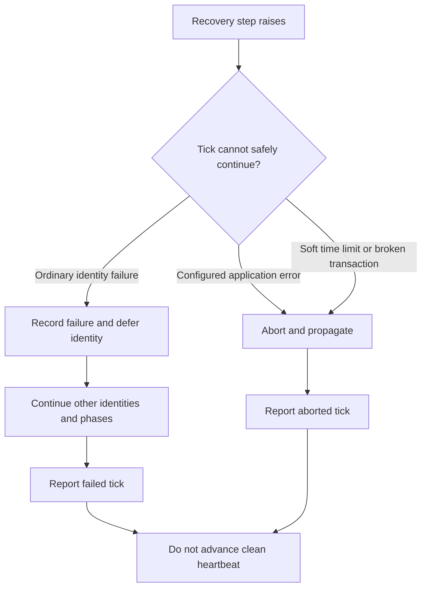

# Django and Celery integration

Use one writable PostgreSQL database for the product row, its work row, Due's
attempt evidence and recovery deferrals. This release uses Django's default
transaction connection; cross-database atomic admission is not supported.

1. Add `due.django` to `INSTALLED_APPS` and migrate.
2. Define your concrete work models, owner relation, captured input fields and
   `durable_work_schema(...)`. Generate and apply your application migrations.
3. Implement a capability with an explicit `DurableWorkPolicy` and register it
   in every web, worker, Beat, management-command and test process that uses it.
4. Include `due.django.runtime.tasks` in the Celery app's imports and merge the
   generated recovery schedules with your application's existing Beat schedule.
5. Run workers for the registered queues and a recurring scheduler. Alert on
   outstanding work and stale recovery heartbeats.

The complete registration pattern is in `examples/documents/apps.py`:

```python
from due.django.runtime.registry import (
    DurableWorkRegistration,
    index_durable_work_registrations,
    install_registrations,
    recovery_schedules,
)

routes = [DurableWorkRegistration(name="publish_document", capability=publication)]
install_registrations(index_durable_work_registrations(routes))
settings.CELERY_BEAT_SCHEDULE = {
    **settings.CELERY_BEAT_SCHEDULE,
    **recovery_schedules(routes),
}
```

Resolve registrations before executing work. Missing registration is a startup
or deployment defect, not a retryable provider failure. Stable names are part of
the message contract. With `django-celery-beat`, the optional
`remove_stale_recovery_schedules(routes)` removes only unowned **Due** schedules.
It does not remove another application's task names.

## One composition root, every process

Keep application wiring in one explicit startup function. Django loads your
models before capabilities can safely be registered; invoke that function after
Django setup and before accepting requests or consuming tasks. A configured web
process does not configure a separately started worker or Beat process.

```text
                    application startup / composition root
                                      |
                 +--------------------+---------------------+
                 |                    |                     |
          ApplicationHooks     capability registry    recovery schedules
          tenant + read pin    stable route names     same cadence/queues
          fatal error types    worker time limits     as the worker registry
                 |                    |                     |
                 +--------------------+---------------------+
                                      |
                    web / worker / Beat / commands
                    each process installs its own copy
```

For an existing database, read the migration section below **before** running
Due's initial migration. The quick-start steps above describe a fresh install.

## Tenant, replica and fatal-error hooks

The persisted `universe` field is the tenant key. The default implementation
restores a context-local tenant available through `current_tenant()`.
Applications that already own tenant context and replica pinning install their
existing implementations once during startup. In this sketch the three names
are application-owned: a tenant context manager, a read-pin function, and the
exception class raised when an application dependency has not been installed:

```python
from due.django.integration import ApplicationHooks, configure

configure(
    ApplicationHooks(
        tenant_scope=my_application_tenant_scope,
        pin_after_write=my_application_pin_after_write,
        abort_recovery_on=(ApplicationNotInstalled,),
    )
)
```

Override `work_beneficiary_user_id()` when settlement must pin a beneficiary's
subsequent reads. Hooks preserve the existing backend boundary without Due
importing its code. Registration/configuration is process-wide; configure before
serving requests, not per request. The tenant context manager must restore its
previous value even when work fails. Due also maintains its own `current_tenant()`
context around that application scope.

### A bad row is different from a broken process

A malformed identity must not prevent other identities from recovering. A missing
application service invalidates the whole tick. Register its **exception type**
with `abort_recovery_on`; matching a class name or inheriting from Due's private
installation error is unnecessary.



The classifier follows exception causes and contexts, including a wrapper raised
by a lock helper. Existing Due wiring errors and Celery soft limits still abort,
even when the application declares no extra types. Per-call `propagate` types on
`recovery_tick` continue to apply too.

Choose narrow configuration-error classes. Registering `Exception` would abort on
every ordinary row failure and remove poison isolation. This hook classifies
**recovery** errors; it does not change provider replay permission or the
execution capability's error policy. No error clears UNKNOWN evidence.

The executable [recovery isolation test](../tests/capabilities/test_operation_recovery_isolation.py)
runs both receipt settlement and negative-evidence recovery. It checks that a
fatal application error leaves the next identity untouched and creates no row
backoff, while an ordinary error lets that identity progress. The
[reporting test](../tests/runtime/test_recovery_pass.py) also checks aborted
outcomes and the absence of a clean heartbeat.

## Adopting the extraction in an existing backend

This repository does not migrate the originating backend automatically. Preserve
its product/work tables, captured fields, migration history, registered task names
and unresolved provider evidence during a separate consumer cutover.

- Change library imports to `due.django`, with pure contracts in `due.errors`,
  `due.observations` and `due.retry_delays`.
- Retain concrete model/table identities. Historical migrations must keep their
  frozen schema definitions; never rewrite migration history to import live code.
- Due's concrete tables are `due_effectattempt` and `due_recoverydeferral`.
  Move existing evidence with an explicit, reviewed data/state migration and
  repoint receipt foreign keys. Do not initialize empty evidence tables beside
  existing uncertain operations or copy only the work rows.
- Drain or route old task names before removing their worker entry points. Only
  after the data/route cutover should all processes use Due's registrations.
- Configure existing tenant/routing/fatal-error hooks and update monitoring to `due_*` metrics.
- Run the existing application lifecycle tests and generated contracts through
  the new imports before removing the original implementation.

The retained class/method names reduce source changes. Migration and queued-message
compatibility still require deliberate handling; this is not a zero-migration swap.
All 17 registrations in the originating backend are work tables; there are no
direct production adopters of its native lifecycle APIs. Two production modules
use a counter helper located in the old `native` package; that arithmetic import
can stay backend-owned or be relocated separately. Older application workflows
and their tests do not need to adopt a native API to survive the work-table port.

Use the [backend audit](backend-adoption.md) for application migration gates and
the [conformance guide](conformance.md) to bind the existing domain suites.
