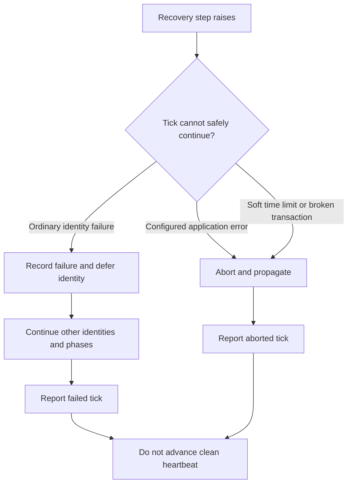

# Django and Celery integration

Use one writable PostgreSQL database for the product row, its work row, Due's
attempt evidence and recovery deferrals. This release uses Django's default
transaction connection; cross-database atomic admission is not supported.

1. Add `due.django` to `INSTALLED_APPS` and migrate.
2. Define your concrete work models, owner relation, captured input fields and
   `durable_work_schema(...)`. Generate and apply your application migrations.
3. Implement a capability with an explicit `DurableWorkPolicy` and register it
   in every web, worker, Beat, management-command and test process that uses it.
4. Call `configure_durable_work` once to install the manifest, task imports and
   recovery schedules. Configure Celery from Django settings or pass its app explicitly.
5. Run workers for the registered queues and a recurring scheduler. Alert on
   outstanding work and stale recovery heartbeats.

The complete registration pattern is in `examples/apps.py`:

```python
from due.django.runtime.registry import configure_durable_work
from myapp.registry import REGISTRATIONS

# In AppConfig.ready(): one manifest owns routes, task imports and Beat schedules.
configure_durable_work(REGISTRATIONS)
```

This validates and installs registrations, adds Due's task module to
`CELERY_IMPORTS` and merges recovery schedules with existing Django settings.
Unrelated imports and schedules are preserved. A generated schedule name owned
by another task or route is an error, checked before configuration changes.
Repeating the same setup is safe; an existing schedule for the same Due route is
updated from the manifest.

If the Celery app already loaded its configuration or does not read Django's
`CELERY_*` settings, pass that app during startup:

```python
configure_durable_work(REGISTRATIONS, celery_app=my_celery_app)
```

This also updates the explicit app's task imports and recovery schedule. It does
not change broker URLs, serializers or unrelated application settings. Configure
before starting workers or serving requests; this is not a running-worker reload.
No import-time autodiscovery or application dependency is added to Due.

Run `python -m django due_check` in the same environment as each process. This
command verifies configuration, not remote broker connectivity or worker
availability. The lower-level registry functions remain available for applications
that own their setup explicitly.

Resolve registrations before executing work. Missing registration is a startup
or deployment defect, not a retryable provider failure. Stable names are part of
the message contract. With `django-celery-beat`, the optional
`remove_stale_recovery_schedules(routes)` removes only unowned **Due** schedules.
It does not remove another application's task names.

## One composition root, every process

Keep application wiring in one explicit startup function. Django loads your
models before capabilities can safely be registered; invoke that function after
Django setup and before accepting requests or consuming tasks. A configured web
process does not configure a separately started worker or Beat process.

```text
                    application startup / composition root
                                      |
                 +--------------------+---------------------+
                 |                    |                     |
          ApplicationHooks     capability registry    recovery schedules
          tenant + read pin    stable route names     same cadence/queues
          fatal error types    worker time limits     as the worker registry
                 |                    |                     |
                 +--------------------+---------------------+
                                      |
                    web / worker / Beat / commands
                    each process installs its own copy
```

For an existing database, read the migration section below **before** running
Due's initial migration. The quick-start steps above describe a fresh install.

## Tenant, replica and fatal-error hooks

The persisted `universe` field is the tenant key. The default implementation
restores a context-local tenant available through `current_tenant()`.
Applications that already own tenant context and replica pinning install their
existing implementations once during startup. In this sketch the three names
are application-owned: a tenant context manager, a read-pin function, and the
exception class raised when an application dependency has not been installed:

```python
from due.django.integration import ApplicationHooks, configure

configure(
    ApplicationHooks(
        tenant_scope=my_application_tenant_scope,
        pin_after_write=my_application_pin_after_write,
        abort_recovery_on=(ApplicationNotInstalled,),
    )
)
```

Override `work_beneficiary_user_id()` when settlement must pin a beneficiary's
subsequent reads. Hooks preserve the existing backend boundary without Due
importing its code. Registration/configuration is process-wide; configure before
serving requests, not per request. The tenant context manager must restore its
previous value even when work fails. Due also maintains its own `current_tenant()`
context around that application scope.

### A bad row is different from a broken process

A malformed identity must not prevent other identities from recovering. A missing
application service invalidates the whole tick. Register its **exception type**
with `abort_recovery_on`; matching a class name or inheriting from Due's private
installation error is unnecessary.



The classifier follows exception causes and contexts, including a wrapper raised
by a lock helper. Existing Due wiring errors and Celery soft limits still abort,
even when the application declares no extra types. Per-call `propagate` types on
`recovery_tick` continue to apply too.

Choose narrow configuration-error classes. Registering `Exception` would abort on
every ordinary row failure and remove poison isolation. This hook classifies
**recovery** errors; it does not change provider replay permission or the
execution capability's error policy. No error clears UNKNOWN evidence.

The executable [recovery isolation test](../tests/capabilities/test_operation_recovery_isolation.py)
runs both receipt settlement and negative-evidence recovery. It checks that a
fatal application error leaves the next identity untouched and creates no row
backoff, while an ordinary error lets that identity progress. The
[reporting test](../tests/runtime/test_recovery_pass.py) also checks aborted
outcomes and the absence of a clean heartbeat.

## Adopting the extraction in an existing backend

This repository does not migrate the originating backend automatically. Preserve
its product/work tables, captured fields, migration history, registered task names
and unresolved provider evidence during a separate consumer cutover.

- Change library imports to `due.django`, with pure contracts in `due.errors`,
  `due.observations` and `due.retry_delays`.
- Retain concrete model/table identities. Historical migrations must keep their
  frozen schema definitions; never rewrite migration history to import live code.
- Due's concrete tables are `due_effectattempt` and `due_recoverydeferral`.
  Move existing evidence with an explicit, reviewed data/state migration and
  repoint receipt foreign keys. Do not initialize empty evidence tables beside
  existing uncertain operations or copy only the work rows.
- Drain or route old task names before removing their worker entry points. Only
  after the data/route cutover should all processes use Due's registrations.
- Configure existing tenant/routing/fatal-error hooks and preserve or explicitly migrate the configured metric namespace.
- Run the existing application lifecycle tests and generated contracts through
  the new imports before removing the original implementation.

The retained class/method names reduce source changes. Migration and queued-message
compatibility still require deliberate handling; this is not a zero-migration swap.
All 17 registrations in the originating backend are work tables; there are no
direct production adopters of its native lifecycle APIs. Two production modules
use a counter helper located in the old `native` package; that arithmetic import
can import the existing `due.django.runtime.counters` arithmetic helper. Older application workflows
and their tests do not need to adopt a native API to survive the work-table port.

Use the [backend audit](backend-adoption.md) for application migration gates and
the [conformance guide](conformance.md) to bind the existing domain suites.


## Migrating an existing application

Configure these settings before Django imports Due:

| Setting | Default | Purpose |
| --- | --- | --- |
| `DUE_EFFECT_ATTEMPT_TABLE` | `due_effectattempt` | Existing evidence table name |
| `DUE_RECOVERY_DEFERRAL_TABLE` | `due_recoverydeferral` | Existing recovery-deferral table name |
| `DUE_TASK_NAMESPACE` | `due.django.runtime.tasks` | Stable names understood by existing workers |
| `DUE_METRIC_NAMESPACE` | `due` | Stable Prometheus family prefix |

Changing a table setting does not move data or rewrite migrations. An adopter
with existing tables must supply its reviewed Django migration module, preserve
physical constraints and foreign keys, and prove forward/backward migration with
populated rows. Keep that application migration history current when adopting
future Due schema changes. New applications should use the default tables and
shipped migrations.

Keep task names stable during rolling deployments: changing a Python import is
separate from changing the Celery message name. Older historical aliases can be
bound by the application's Celery registry to the same task objects. Pass exact
`retired_task_names=(...)` to `remove_stale_recovery_schedules` when reconciling
persisted Beat entries under previous names; another application's recovery task
must never be removed by a suffix match.

`due.django.runtime.metrics.metric_schemas()` exposes read-only label schemas and
enum vocabularies from the declarations that construct the metrics. Applications
can check alerts against this catalog without duplicating metric definitions.
