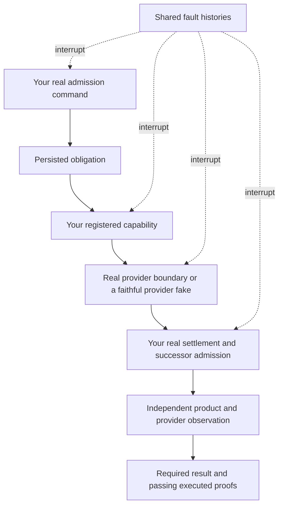

# Follow one obligation through a lost message

This walkthrough uses the repository's document publisher: PostgreSQL stores a
document and its publication work; the effect writes an immutable revision file;
fenced settlement publishes that file's key on the document. There is no fake
settlement or test-only recovery implementation.

Start with the [README setup](../README.md#run-the-example). The commands below
run from the repository root with the local PostgreSQL and Redis services ready.
Tests create their own PostgreSQL test database; do not point them at production.

## The message disappears; the obligation stays

```text
TIME      PRODUCER                DATABASE                  TRANSPORT / WORKER
 t0       request_publication --> document + work
 t1       commit                  work is owed
 t2       post-commit nudge ----------------------------X    notification lost
 t3                               work still owed
 t4                                                        recovery task runs
 t5                               queued delivery <------- select + reserve
 t6                               claimed <--------------- worker claims token
 t7                                                        write revision file
 t8                               document points to file <- fenced settlement
                                  work succeeded
```

The test withholds the initial notification, starts a separate Celery prefork
worker, sends recovery through Redis, then reads both the file and the product
pointer from PostgreSQL:

```bash
uv run pytest tests/integration/test_celery_worker.py -v
```

Its assertions distinguish three facts: a worker attempted the effect, the file
contains the requested text, and the product points to that result. Looking only
at `state == "succeeded"` would miss a broken application finalizer.

## Kill the process around the external write

The document conformance suite also starts child processes and terminates them
with `os._exit` at named boundaries:

```text
ADMIT                          WRITE FILE                         SETTLE
  |                                |                                |
  +-- death after admission        +-- death before file write      |
                                   +-- death after file write ------+

recovery must find the committed work and eventually publish the right file
```

A repeated file write is allowed because this example uses a stable revision key
and safely repeatable contents. This is not a recipe for replaying a charge, a
provider create operation, or another non-repeatable action. Use
[the evidence-required lifecycle](architecture.md#an-unknown-outcome-needs-evidence)
when the external operation cannot safely be repeated.

Run the full generated application contract and emit its actual evidence:

```bash
uv run pytest tests/conformance/test_document_contract.py \
  -p due.django.conformance.reporting \
  --due-work-require-assessed \
  --due-work-profile-report=profiles.json \
  --durable-work-report=effects.json \
  --durable-observation-report=observations.json
uv run python scripts/check_adoption_report.py profiles.json \
  --contract publish_document --verified A B D E H I J \
  --effect-report effects.json --effect publish_document
```

The gate checks execution, not just declaration. Selected proofs must actually
run and pass; a partial or empty report cannot stand in for the application suite.
The declared E-family dispositions still matter: a snapshot proof does not imply
that this example exercises every possible interleaving family.

## Make a proof fail on purpose

A green history is useful only if the proof notices the behavior it claims.
[The process negative control](../tests/conformance/test_document_process_control.py)
disables the production recovery method and requires the canonical process oracle
to reject the resulting unfinished publication. The test itself passes only when
the broken behavior is detected:

```bash
uv run pytest tests/conformance/test_document_process_control.py -v
```

The same pattern guards [gates, dependent wakes, receipt repair, rejection policy
and query scale](conformance.md#prove-the-proof-and-use-exploration-where-it-applies).
These controls belong beside the library's generated assertions; an adopter
should bind its domain examples rather than copy the assertions into each app.

## Bring your own product meaning



Keep the capability, transaction and recovery methods real. Replace only external
providers when needed, and make their fakes retain accepted requests if the real
provider can complete after a timeout. Observe required cleanup and successors,
not just the first successful step. Use an independent `HandoffHistory.expected`
value so every history agreeing on a wrong result still fails.

Next: [bind a capability](conformance.md), [install application hooks](integration.md),
or [inspect stopped and uncertain work](operations.md). The
[backend migration status](backend-adoption.md) keeps package guarantees separate
from the originating application's unexecuted migration gates.
