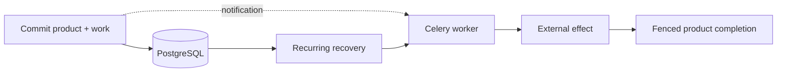
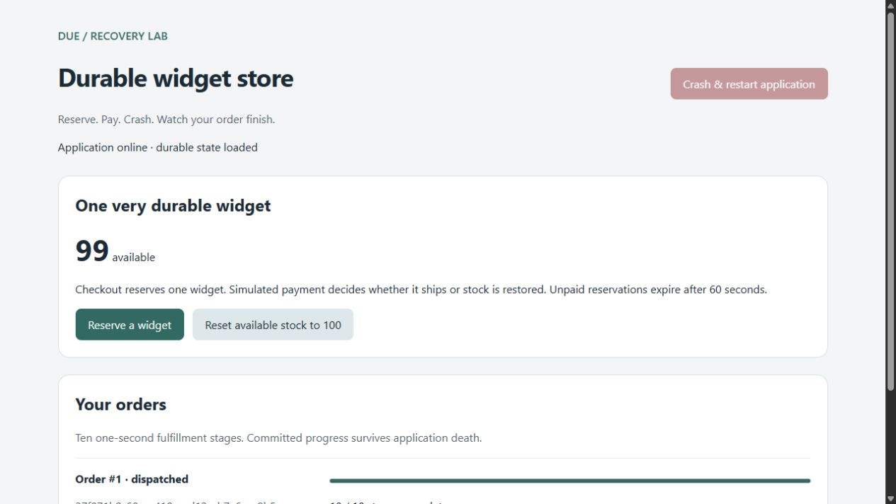

# Keep background work owed until your application finishes it.

A database commit can succeed while its queue notification disappears. Due
stores a work row alongside the product change, retries delivery through Celery,
and fences which worker can publish completion. Your application owns the
meaning of success and whether an external operation is safe to repeat.

[Run and recover your first task](../package/docs/quickstart.md){ .md-button .md-button--primary }
[Choose an API](../package/docs/api-guide.md){ .md-button }

## Start with a background function

The [tutorial](../package/docs/quickstart.md) uses a function that sleeps, prints
a greeting and returns it. You submit it with `.enqueue()`, start a worker, and
retrieve the saved result. Then you kill a worker during a slow job and watch Due
recover it after restart.

The application is deliberately trivial so you can focus on Due. A prepared
project supplies setup. Each step has runnable code and expected output; its
test repeats the journey with real PostgreSQL, Redis, worker death and recovery.
Production imports live in `due.django.public`; common testing imports live in
`due.django.conformance`. [Choose the API and find its imports](../package/docs/api-guide.md).

Next, use the [setup guide](../package/docs/django-tasks-quickstart.md) for your
own project, or the [native work lesson](../package/docs/native-work-tutorial.md)
for application-owned work and guarded completion.

## Install in a Django application

```bash
uv add 'django-due[redis]'
```

The distribution is **django-due**; Python imports use **due**. You need Python
3.14+, Django 6.0.8+ (below 7), PostgreSQL, Celery, a broker, workers and a recurring
recovery scheduler. The API is alpha. Review and lock the installed release.



Follow the [Acme Printworks tutorial](../docs/acme-printworks-tutorial.md) for a
runnable Django Tasks application that grows into native Due capabilities. Always
build its application contract alongside the feature: the shared pytest-obligation
tests make recovery promises executable from the first native capability.

## Your next step

1. [Run the task tutorial](../package/docs/quickstart.md) to submit work, read its
   result, and recover it after stopping the worker.
2. [Follow Printworks](../docs/acme-printworks-tutorial.md) to apply the ideas
   to publication, projections and uncertain provider operations.
3. Use the [integration](../package/docs/integration.md),
   [capability](../package/docs/capabilities.md) and [testing](../package/docs/conformance.md)
   references while building your application.

Due does not provide exactly-once external execution or replace a workflow
engine's history. A stale worker can still reach an external provider; fencing
protects local settlement. Read [guarantees and limits](../package/docs/architecture.md)
and [when to keep your existing tool](../docs/why-due.md) before migrating.

## Already using a task queue?

[Choose your migration guide](../package/docs/migrations.md). Each explains the
source library's identities, retries, results and cutover; one shared native
recipe avoids copying a second recovery implementation into every application.

## See the application outcome



The [Widget Store example](../examples/widget_store/README.md) runs a Django UI,
PostgreSQL, Redis, Celery and scheduled recovery. This screenshot shows a local
simulated order; it is not a production reliability measurement. The crash
control requires the example's supervisor and is disabled in an ordinary
`runserver` session.

## Related tools and support

[Choose a related tool](ecosystem.md) when you also need test selection, CI
measurement or background-work guarantees. Each project works independently.

`latest` follows main and can contain APIs newer than your installed package.
Check the release notes for that version. [Report an issue](https://github.com/gigaverse-app/due/issues)
with a minimal reproducer, or read [the contribution guide](../CONTRIBUTING.md).
