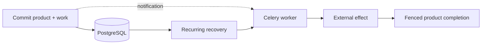

# Keep background work owed until your application finishes it.

A database commit can succeed while its queue notification disappears. Due
stores a work row alongside the product change, retries delivery through Celery,
and fences which worker can publish completion. Your application owns the
meaning of success and whether an external operation is safe to repeat.

[Run the recovery example](../docs/recovery-walkthrough.md){ .md-button .md-button--primary }
[Integrate your application](../package/docs/integration.md){ .md-button }

## Install in a Django application

```bash
uv add 'django-due[redis]'
```

The distribution is **django-due**; Python imports use **due**. You need Python
3.14+, Django 6.0.8+ (below 7), PostgreSQL, Celery, a broker, workers and a recurring
recovery scheduler. The API is alpha. Review and lock the installed release.



## Start with one operation

1. [Run a lost-message recovery](../docs/recovery-walkthrough.md). See the product
   state and file output survive a missing notification and process death.
2. [Choose a capability](../package/docs/capabilities.md). A repeatable file write
   and an uncertain payment need different replay and evidence rules.
3. [Wire models, registration and recovery](../package/docs/integration.md), then
   [bind conformance checks](../package/docs/conformance.md) to your own outcome.

Due does not provide exactly-once external execution or replace a workflow
engine's history. A stale worker can still reach an external provider; fencing
protects local settlement. Read [guarantees and limits](../package/docs/architecture.md)
and [when to keep your existing tool](../docs/why-due.md) before migrating.

## Already using a task queue?

[Choose your migration guide](../package/docs/migrations.md). Each explains the
source library's identities, retries, results and cutover; one shared native
recipe avoids copying a second recovery implementation into every application.

## See the application outcome


The [Widget Store example](../examples/widget_store/README.md) runs a Django UI,
PostgreSQL, Redis, Celery and scheduled recovery. This screenshot shows a local
simulated order; it is not a production reliability measurement. The crash
control requires the example's supervisor and is disabled in an ordinary
`runserver` session.

## Related tools and support

[Choose a related tool](ecosystem.md) when you also need test selection, CI
measurement or background-work guarantees. Each project works independently.

`latest` follows main and can contain APIs newer than your installed package.
Check the release notes for that version. [Report an issue](https://github.com/gigaverse-app/due/issues)
with a minimal reproducer, or read [the contribution guide](../CONTRIBUTING.md).
