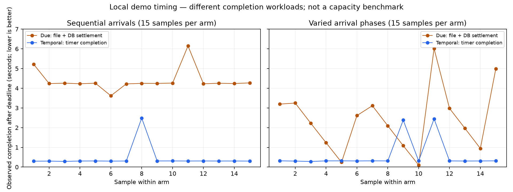
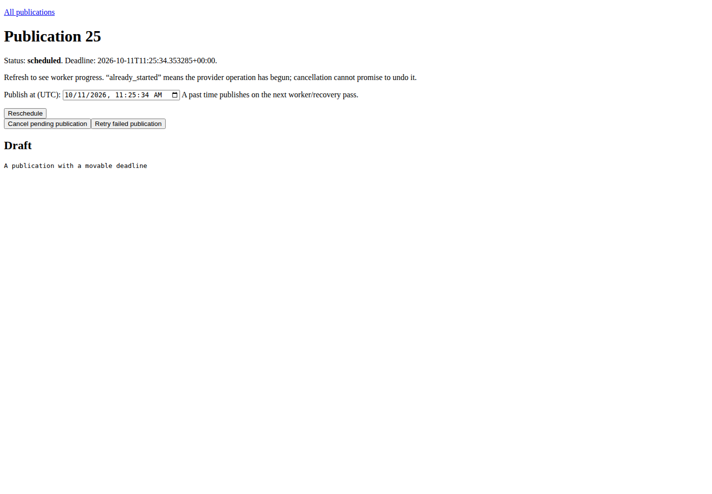
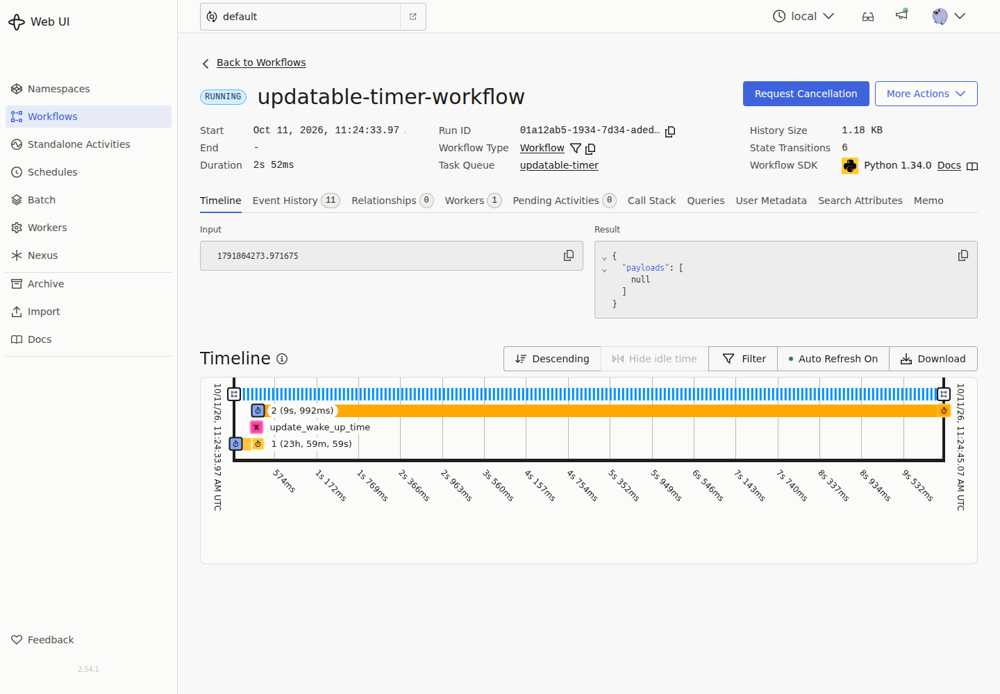
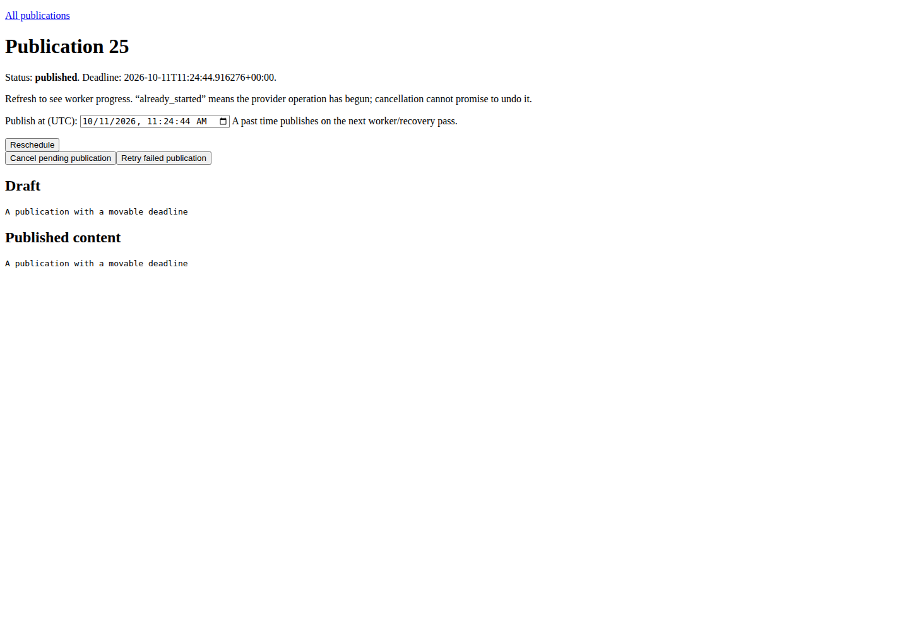
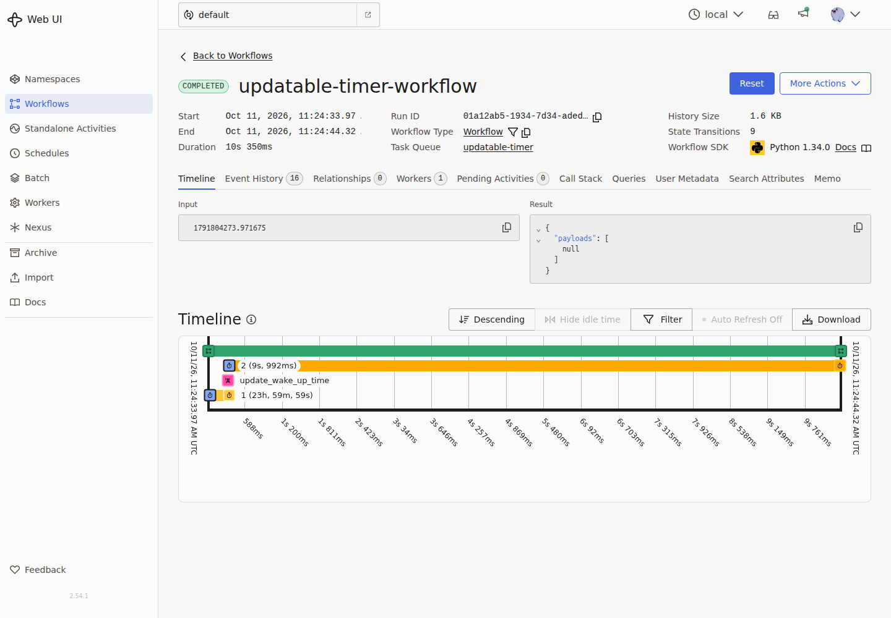
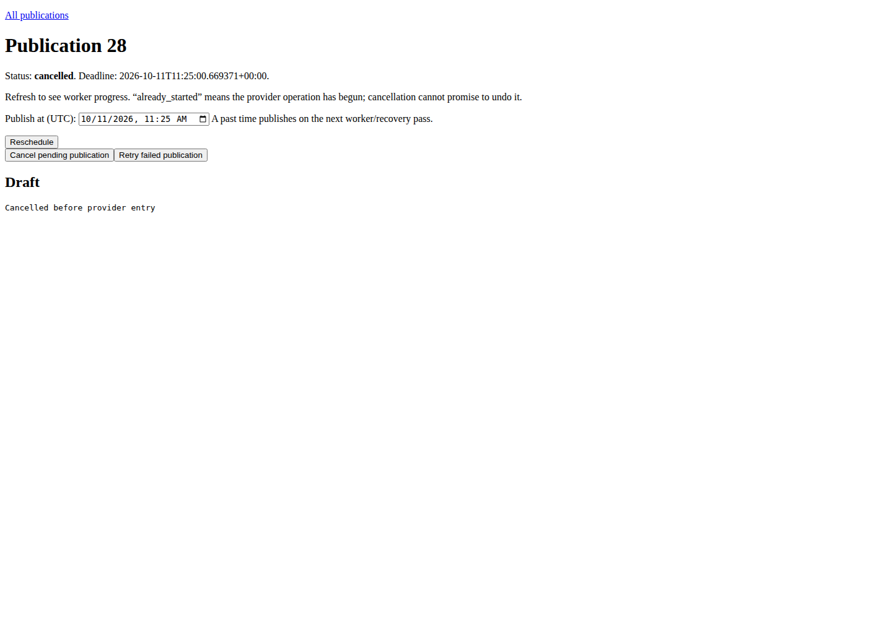
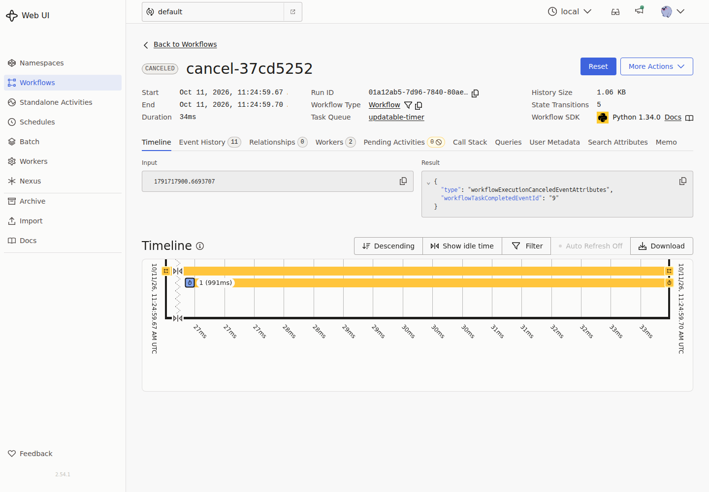

# Due and Temporal: live scheduled-publication comparison

**Evidence only — do not merge this branch.** This report preserves a local run,
not a production performance claim. The maintained application and comparison
guide are in [PR #18](https://github.com/gigaverse-app/due/pull/18).

## Verdict

The Due app is runnable, demoable and tested, and it adapts the original timer's
start → query → move deadline → complete journey. It is **not a complete semantic
port**: upstream's fixed workflow ID prevents duplicate starts while running;
Due's create command creates a fresh publication every time. Due adds a file
provider, product state, cancellation/retry commands and browser that the timer
sample does not contain. It does not reproduce Temporal's history/replay UI.

Both systems passed live deadline-change, pending-cancellation and worker-restart
journeys. Recovery alone is not a Due advantage. Due's architectural advantage
for the BE is co-committing product state and owed work in one Django transaction;
its main exposed gaps are deadline responsiveness, submission identity and
operator visibility. The timing results favor Temporal's timer in this local
configuration, with materially different completion workloads.

## What ran

| Component | Exact version/configuration |
| --- | --- |
| Due | `ff87b074a9e44391189a5246c356a9321f2139bb`; the original PR18 runtime |
| Upstream | [Temporal sample ff0f1343822e532a5c377f02003002d2dcac4f79](https://github.com/temporalio/samples-python/tree/ff0f1343822e532a5c377f02003002d2dcac4f79/updatable_timer), imported unchanged |
| Temporal | CLI 1.9.1 / Server 1.32.0 / UI 2.54.1; SDK 1.34.0; local SQLite persistence |
| Due services | PostgreSQL 17.11 / Redis 7 image / Celery 5.6.3, prefork concurrency 1; existing Beat cadence 5 seconds |
| Python / Django | Python 3.14.7 / Django 6.0.9 |
| Screenshots | Playwright 1.63.0; Chrome for Testing 153.0.8010.12; actual pages, no mockups |
| Host | WSL2, six visible logical CPUs on an i9-12900KS; shared local machine, other load uncontrolled |

[Environment probe](environment.json). PostgreSQL clock differed from the
client midpoint by about -0.06 ms during a 0.93 ms probe; this is a single check,
not continuous clock synchronization evidence.

- Sequential-arrival run: **2026-10-11 11:21:37–11:23:53 UTC**.
- Varied-phase run: **2026-10-11 11:24:32–11:27:26 UTC**.

Each window includes service startup, behavior checks, screenshots and warm-up;
no throughput is calculated from either window.

## Live behavior audit

| Journey | Due | Temporal | Boundary |
| --- | --- | --- | --- |
| Start, change deadline, query, finish | Passed, real file bytes checked | Passed, original starter/updater/worker and workflow query | Temporal finishes a timer; Due publishes a file |
| Move later, pass original deadline, then move earlier | Passed | Passed | No completion observed at the old deadline |
| Stop worker, submit work, pass deadline, restart worker | Passed | Passed | Servers/DB/broker remain running; not a storage/server outage test |
| Cancel pending work, wait past deadline | Cancelled, no published product pointer | Workflow status CANCELED | Temporal uses generic SDK cancellation, not a command in the upstream sample |
| Submit original starter twice | Two distinct Due publications for two create calls | Second original starter reports already running | A real semantic difference, not parity |
| Worker death after external publication / cancellation after entry | Existing Due conformance tests cover it | Not compared | Original Temporal sample has no external publication activity |

See [run3 results and assertions](run3/results.json), the [runner](run_comparison.py),
and [original repeated-starter output](run3/upstream-1-starter.py.log).
The upstream original workflow's [event history](run3/temporal-history.json) is
preserved alongside the worker logs. No activity, timer or recovery implementation
was mocked, and the benchmark used real elapsed time.

## Timings

Each run has **15 samples per arm**, in three blocks of five, alternating arm
order between blocks. Each sample starts a timer 30 seconds ahead and immediately
moves it to 750 ms from the update request. One warm-up per arm is excluded and
retained in the driver log. The second run inserts deterministic 0–4.274 second
pauses to vary the phase relative to Beat. Work is sequential, not controlled-rate
load. There are no benchmark-level retries; SDK/transport defaults remain in place.

The observer polls every 20 ms. Due's completion means a published DB pointer
**and verified file bytes**. Temporal's means a completed workflow returning
`None`. Lateness includes observer/polling/RPC delay; it is not a server execution
timestamp. No early completion was observed. No timing samples or outliers were
removed. p90 is nearest rank (14th of 15); small-sample tails are unstable.

**Observed lateness after final deadline, seconds; lower is better.**

| Arrival pattern | Arm | p50 | p90 | Maximum |
| --- | --- | ---: | ---: | ---: |
| Sequential | Due | 4.249 | 5.214 | 6.148 |
| Sequential | Temporal | 0.306 | 0.310 | 2.485 |
| Varied phase | Due | 2.231 | 4.985 | 6.011 |
| Varied phase | Temporal | 0.312 | 2.382 | 2.446 |



**Command wall time, milliseconds (varied-phase run).** These are different acknowledgement contracts: Due returns after product/work commit plus notification; Temporal returns after server admission or signal acceptance, which need not mean its handler has run. They do not establish an equivalent-API speedup.

| Arm | Start p50 / p90 | Change p50 / p90 |
| --- | ---: | ---: |
| Due | 10.59 / 15.24 | 7.25 / 8.56 |
| Temporal | 9.99 / 16.10 | 14.58 / 17.08 |

**Interpretation:** varying arrival phase changes Due's median substantially,
consistent with its periodic discovery design. Five-second cadence is not a hard
upper bound: both runs contain Due outliers above six seconds. Temporal also has
outliers above two seconds, retained here. The measurements do not isolate their
cause. These results justify improving and measuring deadline wake-ups; they do
not justify a universal speed ratio or production latency SLO.

Raw measurements: [sequential](run2/results.json), [varied phase](run3/results.json).
The applications do different work, persistence differs (PostgreSQL vs dev
SQLite), and host load is uncontrolled. No throughput, CPU, memory, DB cost,
network cost, fleet scaling, provider failure rate or production reliability
benchmark was performed. A matched Temporal publication activity would be the
next prerequisite for an equivalent external-effect performance comparison.

An initial preflight stopped before benchmark sampling because the harness used
exact equality for an epoch float converted to microsecond datetime precision.
The [failed attempt](preflight-failure.log) is retained. The observer was corrected
to a one-microsecond comparison tolerance; the upstream code was not changed.
This was a harness assertion error, not a Temporal defect or excluded timing run.

## Real screenshots

These capture different surfaces: Due's minimal **product page** versus Temporal's
native **engine operator console**. The latter comes with the dev server; it is
not a custom browser application in the upstream sample.

| Due: scheduled product | Temporal: running timer |
| --- | --- |
|  |  |

| Due: file published | Temporal: timer completed with signal/timer history |
| --- | --- |
|  |  |

| Due: cancelled product | Temporal: cancelled workflow |
| --- | --- |
|  |  |

## Advantages, weaknesses, and next work

**Due fits a Django product transaction well.** Product changes and their durable
obligation commit together. Temporal's remote start/signal cannot participate in
that PostgreSQL transaction; a product DB integration needs a reliable bridge,
for example an outbox. The original Temporal timer has no product DB, so this is
an architectural inference from the two boundaries, not a measured failure of
Temporal. Existing Django/Celery users can reuse their stack, and ordinary ORM
commands stay outside a workflow replay model.

**Due's generated application contracts are useful BE adoption tools.** They
exercise admission, rollback, retries, stale snapshots, replay and cancellation
against real product/provider observations. Temporal also has strong
[testing and replay tools](https://docs.temporal.io/develop/python/best-practices/testing-suite).
Sixty-four generated Due cases versus a small upstream example is not a fair
library reliability contest.

**Temporal is more expressive and more observable for workflows.** The original
timer is smaller than Due's publication application, and its UI exposes history,
signals, timers and workers immediately. Due's screenshot makes the missing
operator context concrete. A workflow platform's history/replay/reset and broader
orchestration are not reproduced by a work-table capability.

Recommended order:

1. **Deadline wake-ups.** Add a bounded best-effort wake-up for upcoming deadlines;
   keep PostgreSQL eligibility, stale revision checks and periodic recovery as
   the authority. First experiment with the existing cadence setting, but measure
   scheduler/DB overhead. Acceptance: better lateness distributions under idle
   and load, with no early effect and lost/obsolete hints still recovering.
2. **Admission identity.** Accept a caller-supplied submission key and specify
   same-key/different-input behavior. Acceptance: concurrent submissions and
   client retries create one product and one obligation. This closes the concrete
   repeated-starter parity gap demonstrated above.
3. **Operator view and useful status.** Show current/desired revision, attempts,
   failure reason, next recovery and why cancellation was refused; make refresh
   and action availability clear. Acceptance: diagnose and retry a failed demo
   without opening SQL or logs.
4. **Retention and provider deployment.** Scheduled evidence is retained forever,
   and local file output assumes shared storage. Design safe archival and an
   object-storage provider example with real uncertainty/replay tests.
5. **Scope and adoption friction.** Due currently requires Python 3.14, Django 6
   and PostgreSQL; this upstream sample allows Python 3.10+. Document supported
   consumers before promising migration ease. Keep multi-step workflow and
   capacity comparisons as separate, matched experiments.

The BE should consider Due for product-owned deferred obligations, not because
this demo proves Temporal inferior. For complex cross-service workflows with a
strong need for history/replay/operator tooling, this demo provides no evidence
to replace Temporal.

## Reproduce

Use an isolated local checkout and disposable services. The runner uses ports
25461 (PostgreSQL), 26461 (Redis), 7239/8239 (Temporal/API UI), and 8048 (Due web).
It owns and stops the application/server subprocesses; stop your Docker services
afterward. All credentials below are local example credentials.

```bash
# From the Due checkout at ff87b074a9e44391189a5246c356a9321f2139bb:
uv sync --locked
docker run -d --name due-comparison-pg -e POSTGRES_USER=due -e POSTGRES_PASSWORD=due -e POSTGRES_DB=due_compare -p 127.0.0.1:25461:5432 postgres:17
docker run -d --name due-comparison-redis -p 127.0.0.1:26461:6379 redis:7
# Wait for PostgreSQL readiness before running the driver.
docker exec due-comparison-pg pg_isready -U due

git clone https://github.com/temporalio/samples-python.git /tmp/temporal-samples
git -C /tmp/temporal-samples checkout ff0f1343822e532a5c377f02003002d2dcac4f79
# Download/extract Temporal CLI 1.9.1 from its official release into /tmp/temporal-cli.
uv run --with playwright==1.63.0 playwright install chromium

# Download this evidence directory (including run_comparison.py), then:
uv run --with temporalio==1.34.0 --with playwright==1.63.0 python /path/to/run_comparison.py \
  --repo "$PWD" --upstream /tmp/temporal-samples \
  --temporal-bin /tmp/temporal-cli/temporal --output /tmp/comparison-sequential
uv run --with temporalio==1.34.0 --with playwright==1.63.0 python /path/to/run_comparison.py \
  --repo "$PWD" --upstream /tmp/temporal-samples \
  --temporal-bin /tmp/temporal-cli/temporal --output /tmp/comparison-varied --spread-phase

docker stop due-comparison-pg due-comparison-redis
```

[Temporal CLI release](https://github.com/temporalio/cli/releases/tag/v1.9.1).
The recorded run used an existing Chrome executable; pass `--chromium PATH` to
select one, or omit it to use Playwright's installed Chromium. The original
baseline driver is preserved as [source text](run2-script.py.txt); the current
runner adds phase spreading, duplicate-start assertions and a configurable browser
path. It imports Due and upstream application code rather than reimplementing it.
