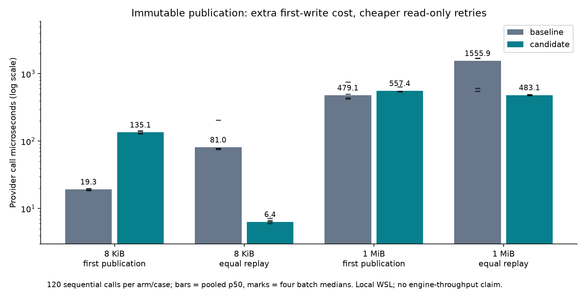

# Application correctness and immutable replay

**Evidence only — do not merge.** Implementation: [Due #21](https://github.com/gigaverse-app/due/pull/21), shared oracle: [pytest-obligation #56](https://github.com/gigaverse-app/pytest-obligation/pull/56).

The ports exposed two weaknesses: process histories could agree on a consistently wrong product outcome, and the file provider rewrote an existing revision on every replay. The fixes require independent outcomes in Due's process bindings and publish immutable bytes atomically without overwriting an existing winner. Equal retries read and compare; conflicting retries fail. No SQL mechanism changed and no ledger rows were added.

## Measurements

This is a sequential diagnostic of the shared local file provider, not a Due-versus-Temporal throughput test. Baseline source: Due `5795f0c5db8c49618ddb806ec189d64e17a19140`; candidate provider: `92bfacdb2f23b1b1959e40ae02364fef9103edee`. Both use the same Python 3.14.7 runtime and WSL2 Linux filesystem. Source SHA-256 hashes and exact UTC timestamps are recorded in [raw results](provider-results-final.json).

Measured window: **2026-10-12 10:51:10.726–10:51:12.694 UTC**. Four batches alternate baseline/candidate order; each batch performs 30 serial calls per case (120 samples per arm/case, 960 total). Each subprocess warms a separate revision first. Replay cases create the destination before timing. Read-back checks verify complete output after every operation, outside latency timing. No retries, queue, broker, database or network participate; no rate or capacity claim is made. This is a shared developer machine with uncontrolled co-tenant load and warm caches, not a fixed-capacity environment.

| Payload / operation | Before p50 / p90 (µs) | After p50 / p90 (µs) | Content bytes written per call, before → after |
| --- | ---: | ---: | ---: |
| 8 KiB first publication | 19.3 / 37.6 | 135.1 / 211.2 | 8 KiB → 8 KiB |
| 8 KiB equal replay | 81.0 / 371.6 | 6.4 / 11.6 | 8 KiB → 0 |
| 1 MiB first publication | 479.1 / 780.0 | 557.4 / 803.9 | 1 MiB → 1 MiB |
| 1 MiB equal replay | 1555.9 / 1839.7 | 483.1 / 541.1 | 1 MiB → 0 |



The robust resource finding is **zero content-write syscalls on equal replay**. Separate `strace` runs check 30 calls per case between explicit measurement markers: baseline replays write 245,760 bytes (8 KiB payload) or 31,457,280 bytes (1 MiB payload); candidate replays make zero content writes. Both first-publication arms write one payload per call. [Counts](write-counts.json) and `trace-*.txt` retain syscall evidence. These are bytes passed to successful `write` calls, not physical storage writes or filesystem metadata operations. The latency series runs without tracing.

Atomic staging costs extra on first publication: approximately 116 µs at the small payload and 78 µs at the large payload in this sample. The local replay timings improve, but batch medians vary (shown as marks), so their ratios are not portable speedup guarantees. The provider still reads the whole existing payload and allocates a byte representation for comparison. A killed staging writer can leave a hidden directory; there is no power-loss/fsync guarantee or automatic orphan retention policy.

## Direct before/after crash check

The same `Path.open` write fault truncates the write to three characters, flushes
and calls `os._exit(73)` in a real child. Both arms use the actual provider source,
with the fault only at the filesystem boundary. The replay case first publishes
`Complete edition` under the same key.

| Case | Baseline externally named file after child | Candidate externally named file after child |
| --- | --- | --- |
| First publication, killed during write | `Com` (partial), exit 73 | Absent, exit 73; partial bytes remain hidden in staging |
| Replay of an already published revision | `Com` (existing content damaged), exit 73 | `Complete edition`, exit 0; no write reaches the armed fault |

[Executable diagnostic](crash_provider.py) and [results](crash-results.json) retain
this concrete failure and correction. This checks process-death visibility, not
power loss. Set the candidate path in the script to a checkout of the named
implementation commit before reproducing it.

## Correctness and comparison

- The same shared outcome oracle now rejects a wrong constant, wrong callback or incorrectly expected `None`. Explicit `None` is also tested as a correct requirement.
- Due requires `ProcessHistory.expected`. Books independently require a correctly authored searchable book and exactly one successor. Scheduled publication requires the published status, exact file content and exactly one deadline row.
- Actual scheduled child processes die after admission, before file publication, after publication and after settlement. Production recovery must converge. Deliberately wrong provider replies and deliberately disabled recovery fail the proofs.
- File-provider tests cover same-key/no-rewrite behavior, conflicting content, overlapping equal/conflicting writers and abrupt death after only a prefix was staged. The final path remains absent until a complete revision is published, and retry recovers.
- CI requires each named application process proof in addition to the existing profile/debt gates. Removing the binding is a failing gate, not a smaller green suite.
- The matched Due/Procrastinate application suite still exercises both implementations against the same external SQLite outcome. Atomic enqueueing and recovery are shared capabilities. The original Procrastinate tutorial adds a five-second simulation delay; it is not a fair latency baseline.
- The pinned Temporal sample only waits, reschedules and queries a timer; it has no external file publication. This provider improvement could equally be used by a Temporal activity. It does not establish a Temporal engine disadvantage.

Initial local full suite: 1,409 passed, four pre-existing expected failures; 92 focused checks passed after the last proof/robustness changes. The current-main integration and final CI results are recorded in the implementation PR. These tests establish the observed scenarios, not arbitrary application correctness.

## Reproduce

Extract the baseline provider with `git show 5795f0c5db8c49618ddb806ec189d64e17a19140:examples/documents/storage.py`; the identical copy is included here. Check out the candidate implementation and run:

```bash
python provider_benchmark.py --baseline storage_baseline.py \
  --candidate /path/to/due/examples/documents/storage.py --output provider-results-final.json
```

`trace_provider.py` runs the same arms under `strace -yy -e trace=write,pwrite64` and counts completed writes to the temporary provider directory inside the markers. Set its candidate source path to that checkout before running. `plot_provider.py` renders the four measured cases from the JSON using Matplotlib. Original provenance and lasting design boundaries are documented in [the implementation comparison](https://github.com/gigaverse-app/due/blob/92bfacdb2f23b1b1959e40ae02364fef9103edee/docs/demo-comparisons.md); [the prior deadline benchmark](../deadline-improvement/README.md) remains separate.
