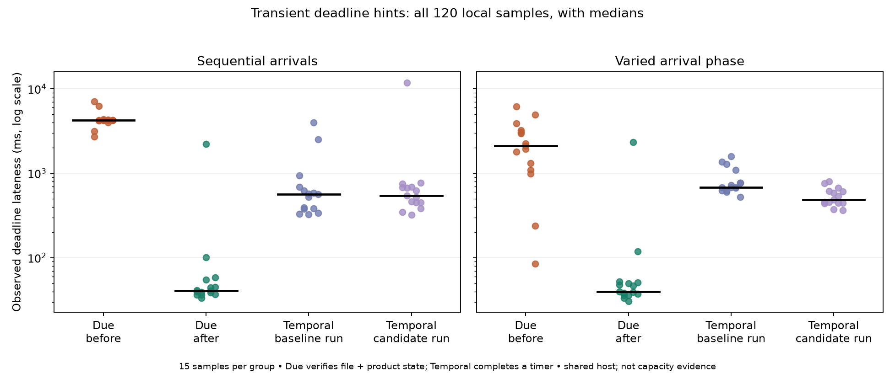
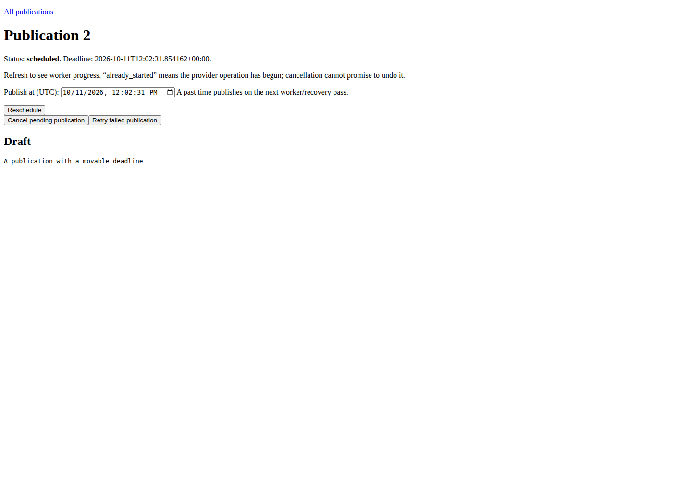
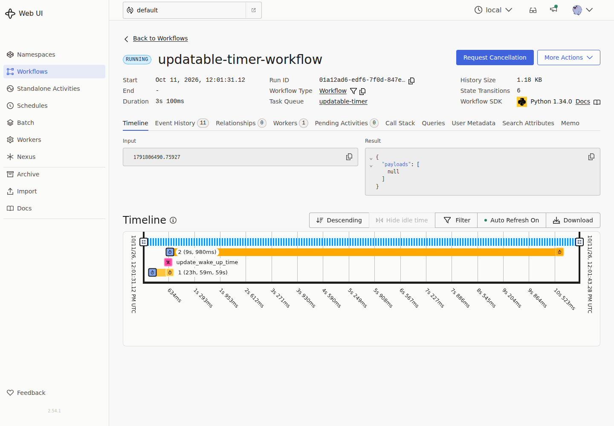
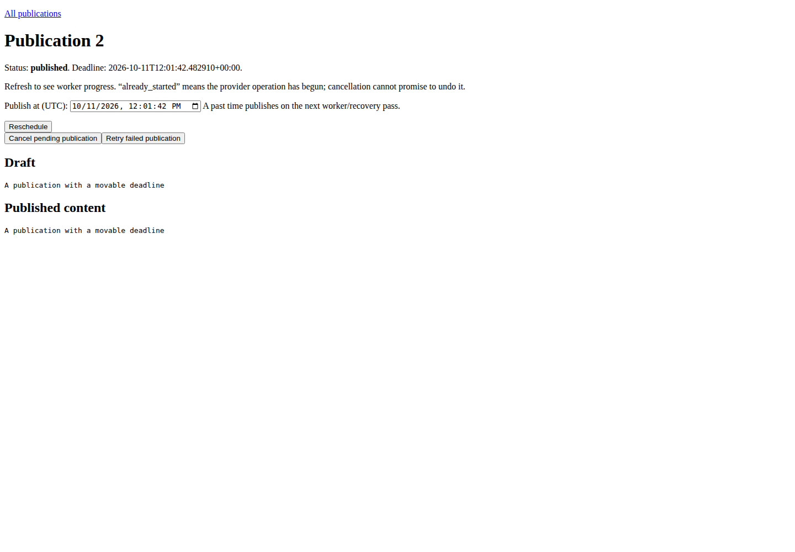
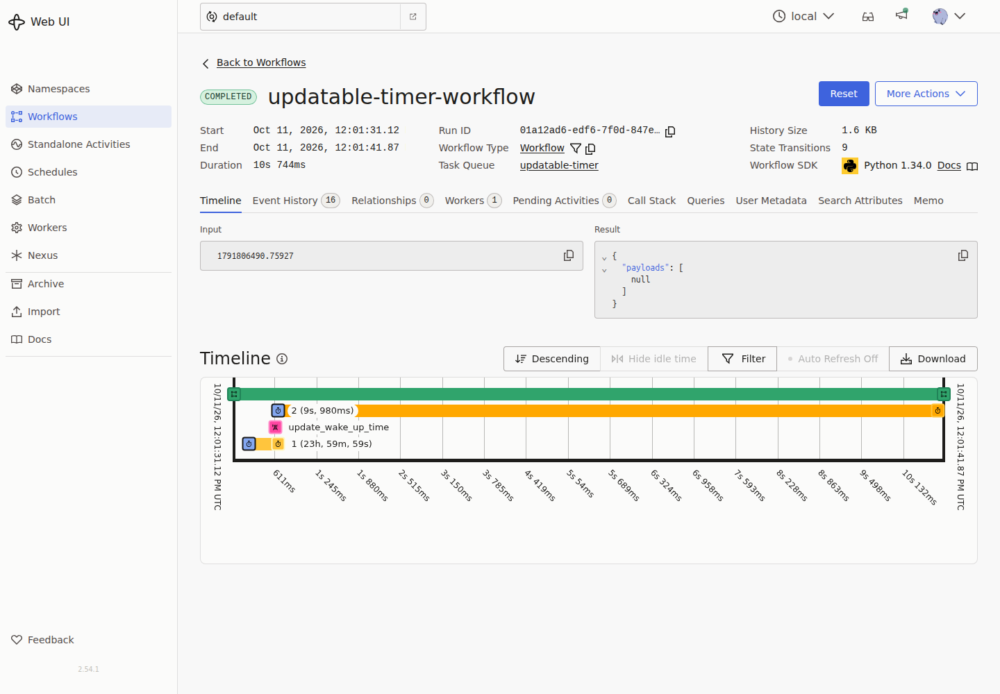
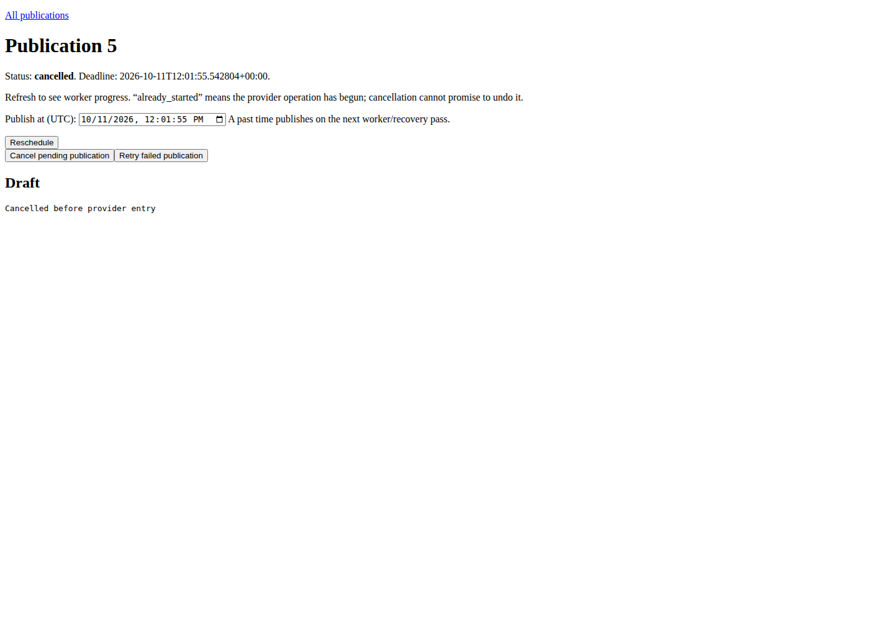
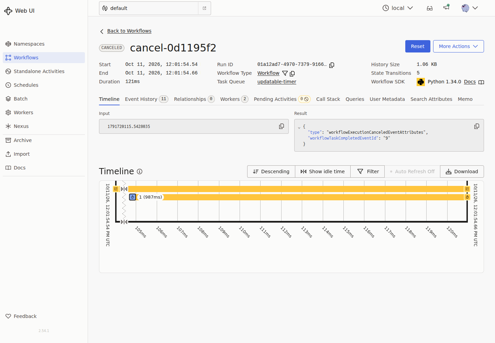

# Deadline wakeups and submission keys: before/after evidence

**Evidence only; do not merge.** Implementation: [PR #18](https://github.com/gigaverse-app/due/pull/18).

## Result

Due’s median observed deadline lateness fell from **4,246 to 41 ms** for sequential
arrivals and **2,099 to 40 ms** with varied arrival phase. The recovery cadence
stayed at five seconds. This isolates a practical polling-delay improvement in
this local setup, not a production SLO or an engine-wide speed ranking.

The new mechanism adds **no SQL rows and no additional write statements** to
create, reschedule or execute one publication in the measured SQL scenario.
Its costs are additional reads, broker messages and short-lived worker timers.
Submission keys use the existing product row; replay of a committed submission
used one SELECT and zero writes. Recovery, cancellation and provider fencing
retain their existing durable rows and writes.

## Sources and method

- Baseline runtime: `ff87b074a9e44391189a5246c356a9321f2139bb`.
- Candidate runtime: `4e49cc0673f2d413b0ef3c36b0662fe16edaabeb` (runtime introduced by `eaa043f`). Later changes repair a test seam and documentation only.
- Unmodified [Temporal Python sample](https://github.com/temporalio/samples-python/tree/ff0f1343822e532a5c377f02003002d2dcac4f79/updatable_timer), commit `ff0f1343822e532a5c377f02003002d2dcac4f79`.
- Same services as the [original comparison](../README.md): PostgreSQL 17.11, Redis 7, Celery 5.6.3 prefork concurrency 1, Beat five seconds; Temporal CLI 1.9.1, server 1.32.0, SDK 1.34.0 with SQLite dev persistence; Python 3.14.7, Django 6.0.9.
- Shared WSL2 developer host, six logical CPUs; other host activity uncontrolled. No local stress/load test, production endpoint, throughput, CPU, memory, storage-byte, WAL or cost benchmark.
- Fresh PostgreSQL database and Temporal SQLite file per run. Original starter, repeated starter and updater were run; real screens were captured in each run. The Due submission check uses one explicit key in candidate runs; baseline creates two rows. Candidate timing admissions also supply a unique key per sample.
- Four runs, order baseline sequential → candidate sequential → candidate varied → baseline varied. Each run alternates Due/Temporal order across three blocks of five. Fifteen measured samples per arm per pattern; one excluded warmup per arm remains in each driver log. No benchmark-level retries or removed outliers.
- Each sample admits a deadline 30 seconds ahead, then moves it to 750 ms from the update request. Varied-phase pauses are `(sample_index + block * .137) % 5` seconds. Completion is observed at 20 ms polling intervals.
- Due completion checks a committed published pointer **and actual file bytes**; Temporal completion is the original timer workflow returning `None`. PostgreSQL/file publication vs SQLite/workflow completion are materially different workloads. Temporal is a reference, not an equivalent-work benchmark.
- UTC windows are retained in each `results.json`. The valid runs span 2026-10-11 11:59:03–12:08:37 UTC, including startup, behavior checks, screenshots and warmups.

[Runner](run_comparison.py) takes `--repo`, `--upstream`, `--temporal-bin`,
`--output`, `--database-url`, optional `--spread-phase`, `--submission-keys`, and
`--chromium`. Run from a Due environment with
`uv run --with temporalio==1.34.0 --with playwright==1.63.0 python run_comparison.py ...`.
Use a new empty database for each run. The driver changes cwd before spawning
processes so every process imports the selected checkout, including a baseline
worktree. It owns and stops its processes; database/broker containers are external.

An initial baseline preflight used the candidate cwd for subprocess `-m` imports,
causing the web process to read a newer schema than the baseline database.
It stopped **before any timing samples**. The driver now changes cwd explicitly;
[the failed preflight log](baseline-seq-preflight-failure.log) is retained.
This was a runner isolation error, not a library failure or excluded timing result.

## Deadline lateness

Milliseconds, lower is better. p90 is nearest rank, the 14th of 15 samples.

| Run | Arm | p50 | p90 | Maximum |
| --- | --- | ---: | ---: | ---: |
| baseline-seq | Due | 4246.2 | 6232.3 | 7033.1 |
| baseline-seq | Temporal | 565.1 | 2524.9 | 3997.1 |
| candidate-seq | Due | 41.0 | 100.8 | 2214.9 |
| candidate-seq | Temporal | 545.1 | 766.4 | 11792.3 |
| baseline-spread | Due | 2099.2 | 4944.4 | 6130.9 |
| baseline-spread | Temporal | 684.0 | 1369.3 | 1583.0 |
| candidate-spread | Due | 40.0 | 119.5 | 2322.0 |
| candidate-spread | Temporal | 485.5 | 757.4 | 801.5 |

The candidate still has 2.2–2.3 second outliers, and Temporal has an 11.8 second
outlier in one run. They are included. The experiment does not isolate the causes;
a short ETA horizon does not bound worker queuing or host scheduling delays.
Small-sample tails are unstable. Inspect the raw sample records and logs rather
than treating medians as latency guarantees.

## SQL rows, statements and broker messages

[SQL accounting driver](measure_sql.py), [baseline SQL](baseline-sql.json),
[candidate SQL](candidate-sql.json). This is a separate **statement-count probe**,
not a wall-time benchmark: real PostgreSQL, production commands/claim/task bodies,
real file writes, shared deterministic broker seam. The clock is real. It creates
one far-future publication, reschedules it to three seconds away, runs one recovery
pass, waits until due, delivers it and (candidate) delivers the duplicate hint.
Candidate additionally retries the original keyed submission before rescheduling.
The baseline invokes normal enqueue at due time; the candidate invokes its real
hint task, which delegates to that same path. Each uses a new database.

Numbers count issued statements, including DB clock reads, not touched-row counts
or physical page/index/WAL writes. Transaction/savepoint commands and exact SQL
are in the raw JSON; table row counts independently confirm no extra ledger.

| Operation | Baseline SELECT | Candidate SELECT | Baseline INSERT / UPDATE | Candidate INSERT / UPDATE |
| --- | ---: | ---: | ---: | ---: |
| Create | 6 | 9 | 2 / 1 | 2 / 1 |
| Same-key retry | Not supported | 1 | — | 0 / 0 |
| Reschedule into near window | 9 | 9 | 0 / 4 | 0 / 4 |
| One recovery pass before due | 11 | 13 | 0 / 0 | 0 / 0 |
| Execute once due | 14 | 16 | 1 / 7 | 1 / 7 |
| Deliver duplicate hint | Not applicable | 2 | — | 0 / 0 |

Final persisted rows in **both** probes: one publication, one scheduled work row,
one effect attempt, zero recovery deferrals. Total writes for the ordinary
create→reschedule→execute path remain **3 INSERT + 12 UPDATE** statements.
The UUID unique index and original-deadline column add storage to the existing
row/index, and the migration backfills existing rows once. No byte-size or index
maintenance cost was measured. Concurrent duplicate inserts can make losing
insert attempts which roll back; the zero-write replay figure is for a retry
**after** the original has committed, not a claim about contending first inserts.

The baseline emits one worker message. The candidate emits two transient hints
(one on reschedule, one on the recovery pass) and one worker message. Duplicate
hints have no durable receipt or SQL write. Recovery sends at most `batch_size`
hints per pass; the ten-second demo horizon bounds timer distance, not global
message count under rapid rescheduling, repeated ticks or many producers.

## Recovery and submission behavior

All four live runs pass deadline changes without observed early completion,
worker restart after deadline, and pending cancellation. Candidate replays the
same submission key into one publication. Temporal’s unmodified starter keeps
one running workflow under its fixed ID. These identities have different lifetime
rules: Due retains its row/key; this is not a claim of Temporal ID-policy parity.

Root tests additionally drop actual timer messages, deliver stale/early/duplicate
hints, preserve retry backoff, bound the lookahead page, and inject a broker
failure without creating recovery-deferral rows or blocking due work. Existing
64 generated application conformance proofs retain recovery/cancellation/worker-
death protection. A real-worker test publishes without Beat. Submission tests
exercise concurrent callers, same-key conflicts, no-write replay, rollback,
completed/cancelled/rescheduled replay, browser/CLI keys and existing-row migration.

CI caught a fault-injection test leaving an instance-level fake Celery method
attached for a later live test. Commit `73917bb` fixes the test to patch the class
boundary. Production runtime is unchanged from the candidate benchmark commit.
Both [CI dependency lanes](https://github.com/gigaverse-app/due/actions/runs/38137957136)
passed **1,397 tests with four existing xfails**, including the required conformance
gates. The focused local sequence of hint, submission, migration and real-worker
checks also passes (20 tests). SQL accounting used `73917bb`, whose runtime matches
the timed candidate; the difference is the corrected test seam.

## Screenshots and raw results

The fresh captures show Due’s product page and Temporal’s engine console; they
are different UI surfaces, not equivalent operator tooling. Representative
candidate-run screenshots:

| Due | Temporal |
| --- | --- |
|  |  |
|  |  |
|  |  |

Raw results: [baseline sequential](baseline-seq/results.json),
[candidate sequential](candidate-seq/results.json),
[baseline varied](baseline-spread/results.json),
[candidate varied](candidate-spread/results.json). Each directory includes worker,
Beat and original CLI logs, screenshots and Temporal workflow history. Driver
logs retain the excluded warmups too.
