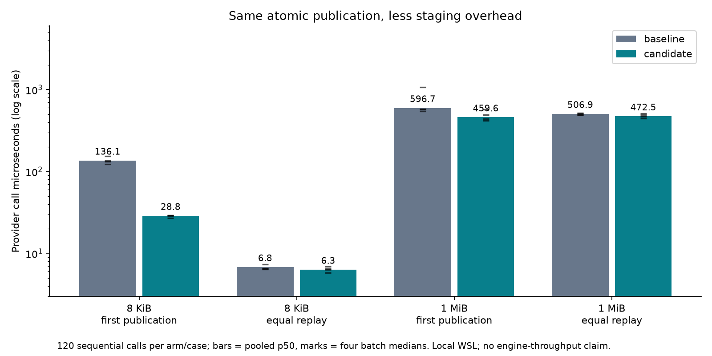

# First publication: retain atomicity, remove staging-directory overhead

The Due file provider's p50 first-publication cost fell by 79% for 8 KiB and 23%
for 1 MiB in this local diagnostic. The change replaces a temporary directory
and recursive cleanup with one exclusively created staging file. Both arms close
the completed file before atomically installing it with a same-filesystem hard
link. Neither arm replaces an existing revision.

This measures the shared demo **provider call**, not HTTP-to-publication latency,
Due vs Temporal throughput, durable-disk latency, or production capacity. It
follows the [application-outcome comparison](../application-outcomes/README.md)
and retains the original [Temporal provenance](../README.md).

- Baseline: Due `012111711be1bd6c163ca28862295116ab181a98`, staged-directory provider.
- Candidate: Due `331fbfa22d980afd35940fa2c9a89252659a2b14`, exclusive staging file.
- Both exact provider files, source hashes, raw samples and scripts are included here.
- Implementation: [Due #21](https://github.com/gigaverse-app/due/pull/21).
- Shared proofs and adopter integration: [pytest-obligation #56](https://github.com/gigaverse-app/pytest-obligation/pull/56).

## Measurements

| Payload / operation | Baseline p50 / p90 µs | Candidate p50 / p90 µs | First-write p50 reduction |
| --- | ---: | ---: | ---: |
| 8 KiB first publication | 136.1 / 206.0 | 28.8 / 58.8 | 78.8% |
| 8 KiB equal retry | 6.8 / 11.1 | 6.3 / 8.6 | — |
| 1 MiB first publication | 596.7 / 1079.8 | 459.6 / 816.5 | 23.0% |
| 1 MiB equal retry | 506.9 / 570.9 | 472.5 / 596.7 | — |



Four alternating batches of 30 sequential calls per arm/case (120 samples),
separate Python processes, warm interpreter and page cache, fresh revision keys
for first publication, one already-published key for retry. File-content
readback is checked outside the timed region. Local Linux/WSL filesystem under
`/tmp`, shared development host; no dedicated CPU or cold-cache controls.
Latency runs have no strace attached. Retry differences are noise on an unchanged
path; the 1 MiB retry p90 is worse, so this is not a retry-speedup claim.

A separate strace run measures provider-path syscall counts for 30 calls:

| Per fresh publication | Baseline | Candidate |
| --- | ---: | ---: |
| Payload write | 1 | 1 |
| Atomic link | 1 | 1 |
| mkdir attempts (includes existing output root) | 2 | 1 |
| Directory-read syscalls for cleanup | 2 | 0 |
| File unlink | 1 | 1 |
| Directory removal | 1 | 0 |

Both arms write exactly the payload size once on first publication and **zero
payload bytes on equal retry**. These are write syscalls, not physical storage
writes. There are no new SQL rows, tables, writes or persistent idempotency records.

## Correctness and recovery

The identical fault writes three bytes, flushes, then calls `os._exit(73)` in a
real child. In both arms the first-publication fault leaves the final revision
absent. On equal retry, the writer fault is never reached and complete published
content survives. See [crash results](crash-results.json).

Due's focused provider suite covers concurrent equal and conflicting writers,
immutable retry inode/mtime, partial-write death plus successful recovery,
ordinary file permissions, exclusive-create collision ownership, and cleanup
plus retry after link failure. Its generated process histories cover admission,
provider write and settlement boundaries and assert independently specified
product outcomes. The shared harness rejects missing outcomes in generated
history contracts; catalog negative controls show that equal wrong output fails
both generated replay proofs. Real Procrastinate, Wagtail, DBOS, Saleor and
Celery worker declarations now bind their intended outcomes.

The guarantees retain their existing scope: exclusively owned local directory,
hard-link support, process interruption rather than power-loss durability. No
fsync was removed (neither arm promises fsync durability). A killed writer may
leave a hidden staging file; quiesce live writers before reclaiming abandoned
staging data. Contract proofs cover declared outcomes and fault boundaries,
not all conceivable application or filesystem failures.

## Reproduce

From this directory, using a Python interpreter compatible with the provider:

```sh
python provider_benchmark.py --baseline storage_baseline.py --candidate storage_candidate.py --output provider-results-final.json
python trace_provider.py
python crash_provider.py
uv run --no-project --with matplotlib python plot_provider.py
```

Raw [latencies](provider-results-final.json), [syscall counts](write-counts.json),
per-arm traces and [benchmark driver](provider_benchmark.py) accompany the report.
This evidence branch remains closed and unmerged; implementation branches contain
code, tests and contracts, not benchmark recordings.
